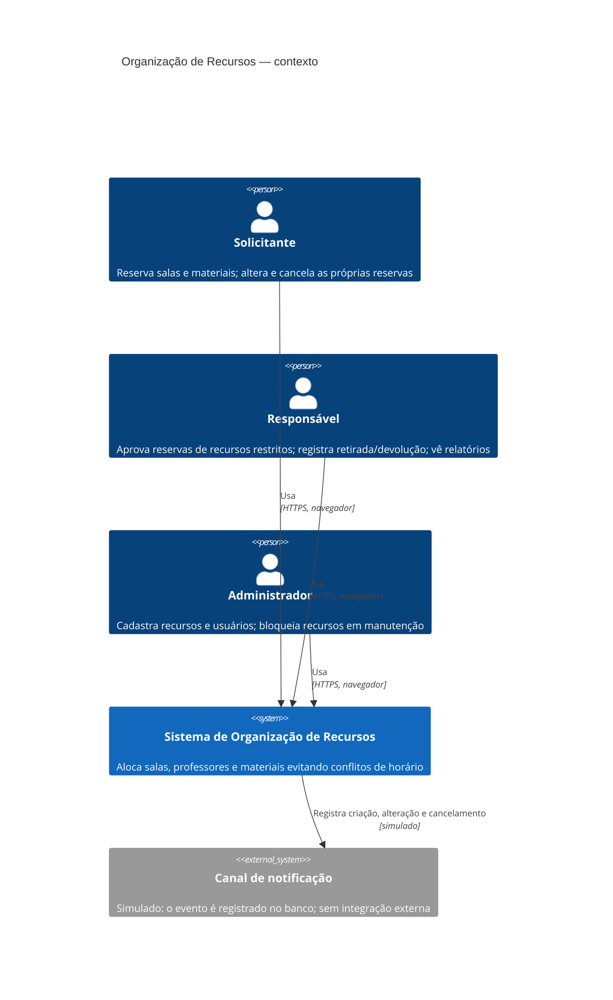
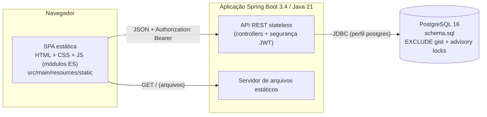
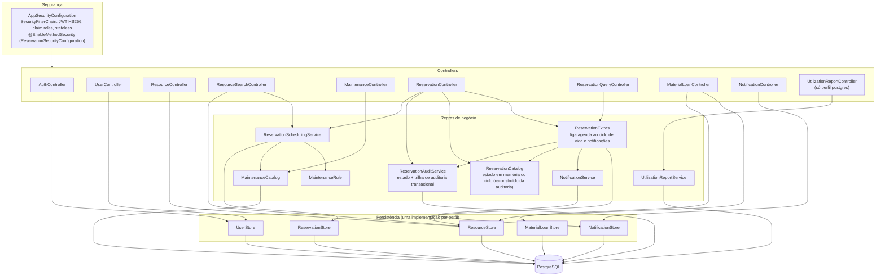
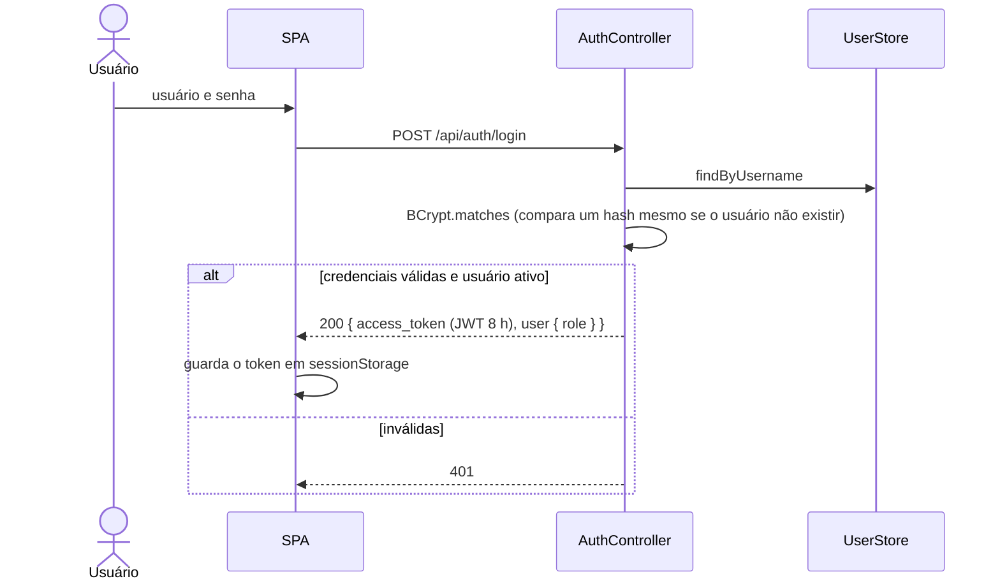
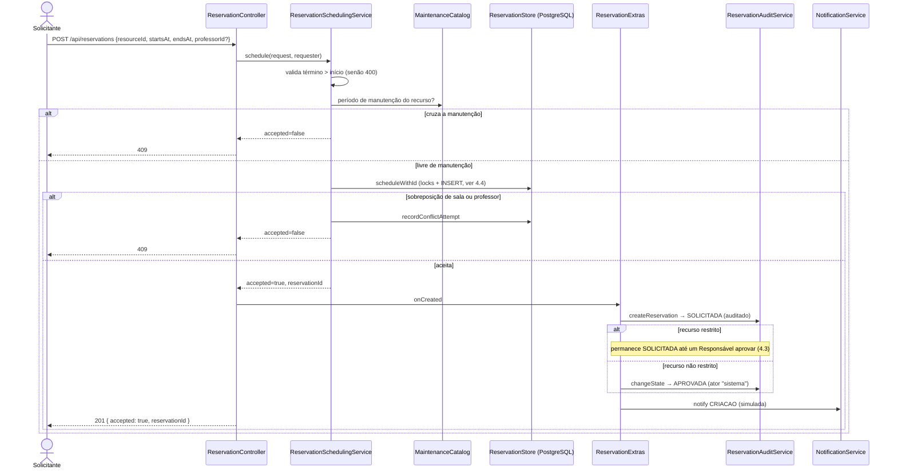
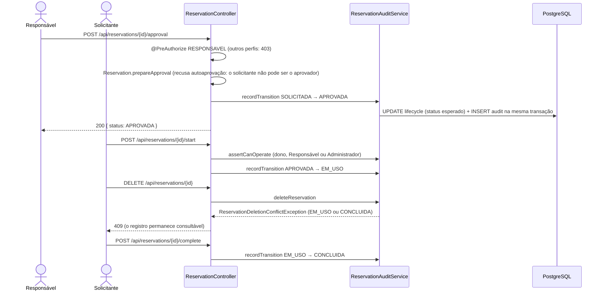
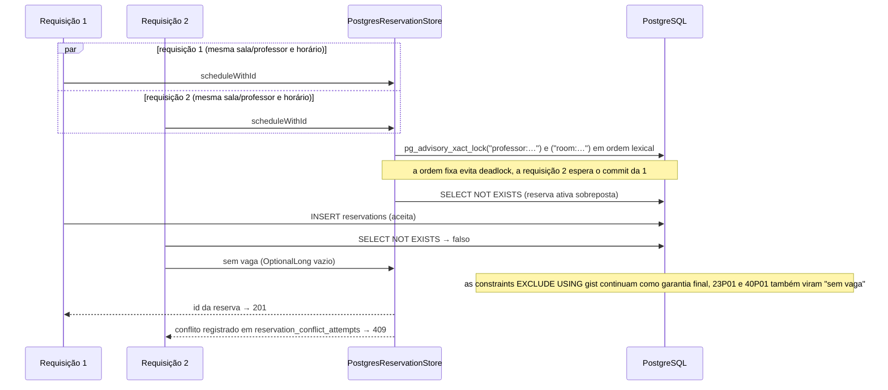
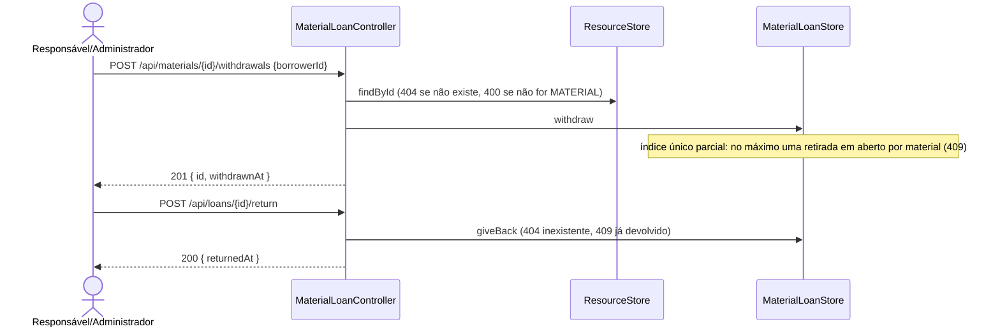

# Arquitetura do sistema implementado

Este documento descreve o que **foi entregue** em `v1.0.0-rc1`. O [documento de arquitetura](arquitetura.md) é o desenho original (anterior à implementação) e inclui propostas que não foram construídas, como o job diário de treinamento. Em caso de divergência, vale este arquivo; os nomes abaixo são os das classes em `src/main/java/br/com/organizacao/recursos/reservas`.

> Os diagramas estão em Mermaid (renderizam no GitHub). Cópias em imagem: [docs/diagramas/](diagramas/).

## 1. Contexto (C4 nível 1)

## 2. Contêineres (C4 nível 2)

Dois modos de execução, escolhidos por perfil do Spring:

| Perfil | Armazenamento | Uso |
|---|---|---|
| `postgres` | PostgreSQL (`Postgres*Store`, `PostgresMaintenanceCatalog`) | Suportado; garante integridade sob concorrência (ADR-001) |
| (padrão) | Memória (`InMemory*Store`) | Somente demonstração; **não detecta sobreposição de horários** |
| `perf` | Login de carga (`PerformanceAuthController`), usado com `postgres` | Teste de desempenho local |

## 3. Componentes da aplicação (C4 nível 3)

Pontos de projeto relevantes:

- **Autorização na fronteira do servidor:** `@PreAuthorize` em cada operação protegida; a interface só esconde ações (RF-01, RNF-01). Matriz verificada por `AuthorizationMatrixIT`.
- **Dois registros por reserva:** a **agenda** (`reservations`, com as constraints de exclusão) e o **ciclo de vida auditado** (`reservation_lifecycle` + `reservation_audit`), ligados pelo id (`reservation_lifecycle.reservation_id = reservations.id::text`). `ReservationExtras` cria o segundo quando o primeiro é aceito.
- **Integridade de horário:** decidida pelo banco (ADR-001), não pela aplicação.

## 4. Sequências críticas

### 4.1 Login

### 4.2 Criar reserva (recurso livre ou restrito, conflito e manutenção)

### 4.3 Aprovação, uso e conclusão (RF-07, RF-14, RF-15)

### 4.4 Disputa concorrente pelo mesmo horário (RF-05, RF-06, ADR-001)

### 4.5 Retirada e devolução de material (RF-09)

## 5. Rastreabilidade com o código

| Diagrama | Teste que exercita |
|---|---|
| 4.1 | `ApplicationFlowTest#loginRejectsWrongPasswordAndProtectedEndpointsRequireToken`, `#roleIsReturnedByLoginAndMe` |
| 4.2 | `ApplicationFlowTest#reservationLifecycleFollowsResourceRestrictionAndNotifiesEvents`, `#maintenanceBlocksReservationsAndCanBeRemoved`, `ApplicationFlowIT#overlappingReservationForSameResourceIsRejectedWithConflict` |
| 4.3 | `ReservationLifecycleTest`, `ReservationApprovalTest`, `ReservationAuditIT`, cenários Cucumber de aprovação |
| 4.4 | `ReservationConcurrencyIT`, `ApplicationFlowIT#concurrentRequestsForSameSlotConfirmOnlyOneReservation` e a [rodada 02 de carga](performance/resultado-02.md) |
| 4.5 | `ApplicationFlowTest#materialWithdrawalAndReturnAreRecordedAndQueryable` |
