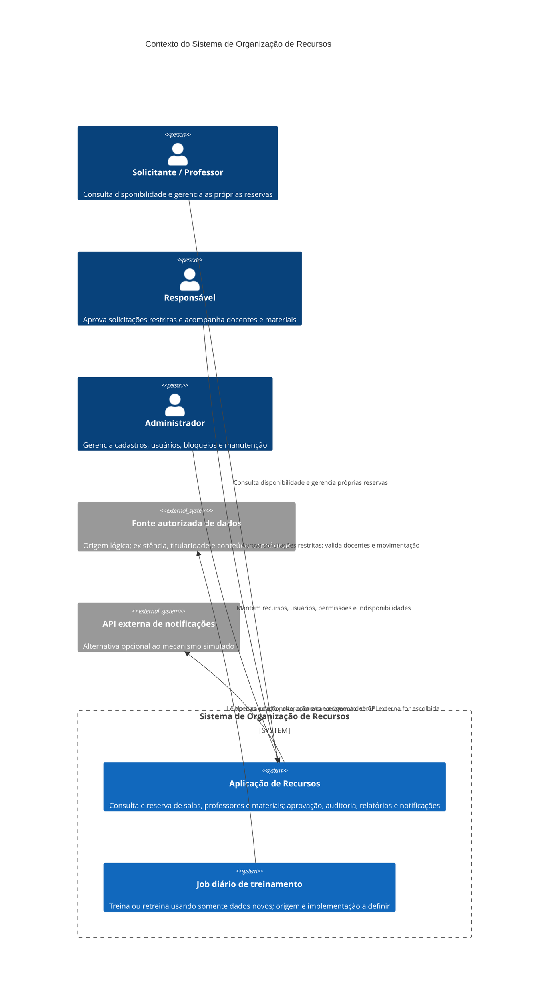
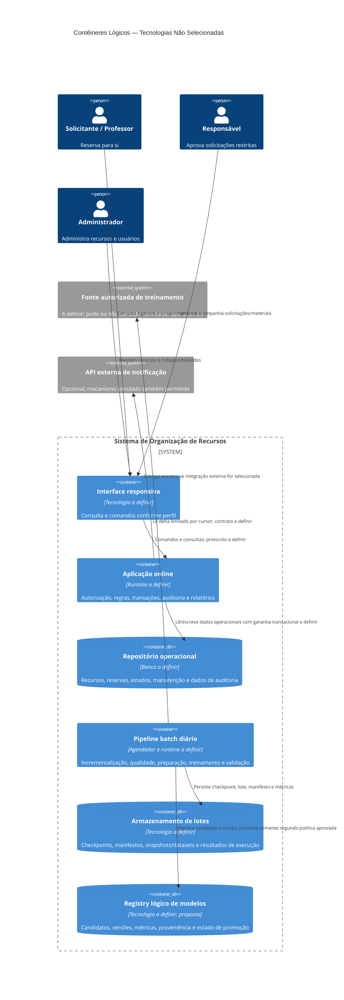
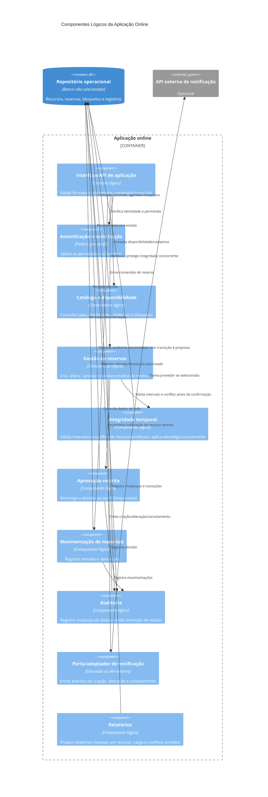

# Arquitetura do Sistema

## 1. Contexto e Objetivo

### Contexto

O projeto visa desenvolver e validar uma aplicação para organizar a alocação de salas, professores e materiais, com prevenção de conflitos de horário. A qualidade da solução deve ser demonstrada por evidências de segurança, rastreabilidade, integridade, testes e desempenho, conforme os requisitos e a matriz de rastreabilidade do projeto.

As fontes documentais consultadas nesta versão são:

- [Personas](personas/): solicitante, responsável e administrador.
- [Requisitos funcionais](requisitos-funcionais.md): `RF-01` a `RF-15`.
- [Requisitos não funcionais](requisitos-nao-funcionais.md): `RNF-01` a `RNF-07`.
- [Matriz de rastreabilidade](matriz-rastreabilidade.md): criticidade, validações planejadas, evidências e gates.
- [README](../README.md): contém apenas o título do projeto, sem decisões arquiteturais adicionais.

Não foram encontrados em `docs/` documentos separados de regras de negócio, restrições ou decisões arquiteturais anteriores. Portanto, esta seção não assume decisões técnicas ausentes das fontes.

### Objetivo arquitetural

Estabelecer os principais drivers que a arquitetura precisa satisfazer: autorizar ações por perfil, manter a consistência da agenda sob concorrência, representar o ciclo de vida de reservas, auditar mudanças e permitir demonstrar os atributos de qualidade definidos. Esta seção registra os drivers e as questões em aberto; não escolhe tecnologias, topologia ou contratos ainda não definidos.

### Restrição de treinamento diário

Foi informada nesta solicitação a seguinte restrição obrigatória: existe um cron job executado diariamente ao final do dia para treinar ou retreinar usando somente dados novos.

Essa restrição ainda não aparece nos artefatos existentes em `docs/`. Sua origem, portanto, é a solicitação atual, não os requisitos documentados. Para incorporá-la ao conjunto formal de fontes de verdade, ela precisa ser registrada posteriormente nos documentos de requisitos e na RTM. Até lá, não se presume tecnologia do job, origem dos dados, definição operacional de “novo”, duração, volume, modelo treinado ou efeito do treinamento sobre o sistema.

## 2. Stakeholders e Personas

| Persona | Responsabilidades documentadas | Limites e observações |
|---|---|---|
| **Solicitante** ([persona-solicitante.md](personas/persona-solicitante.md)) | É o professor; consulta disponibilidade e cria, altera ou cancela suas próprias reservas. | `RF-04` limita o gerenciamento da reserva ao solicitante. A persona não descreve reserva em nome de terceiros. |
| **Responsável** ([persona-responsavel.md](personas/persona-responsavel.md)) | Analisa e aprova solicitações especiais, valida a alocação de docentes e acompanha retirada e devolução de materiais. | Não cria nem gerencia reservas segundo as atividades documentadas na persona; `RF-07` exige seu perfil para aprovar recursos restritos. |
| **Administrador** ([persona-administrador.md](personas/persona-administrador.md)) | Mantém salas, professores, materiais e usuários; gerencia permissões, bloqueios e períodos de manutenção. | A persona não lhe atribui criação ou cancelamento de reservas de terceiros nem aprovação de recursos restritos. |

Não há persona de aluno nos documentos. Como `RF-01` exige autorização por perfil e `RF-04` atribui a criação, alteração e cancelamento ao solicitante (professor), a análise adota como inferência conservadora que um aluno não recebe permissão para reservar. Não se está definindo um novo perfil ou fluxo para alunos.

## 3. Requisitos Arquiteturalmente Significativos

| Driver | Implicação arquitetural | Origem |
|---|---|---|
| Autorização por perfil | As operações devem verificar identidade e permissão; a regra de acesso precisa distinguir solicitante, responsável e administrador. | `RF-01`, `RNF-01`; três personas em `docs/personas/`. |
| Reserva restrita | Uma reserva de recurso restrito não pode ser considerada aprovada sem decisão de perfil Responsável. | `RF-07`; persona Responsável. |
| Integridade temporal | Término posterior ao início; sobreposições devem ser verificadas para sala, material e professor. | `RF-05`, `RF-13`; regras críticas do professor registradas em `matriz-rastreabilidade.md`. |
| Concorrência de reservas | Solicitações incompatíveis simultâneas não podem produzir mais de uma reserva aceita; a proteção precisa ser verificada contra persistência real. | `RF-06`, `RNF-02`; gate de concorrência em `matriz-rastreabilidade.md`. |
| Indisponibilidade por manutenção | Recursos bloqueados durante manutenção não podem ser oferecidos nem reservados no período. | `RF-08`; persona Administrador. |
| Ciclo de vida e imutabilidade operacional | A reserva suporta os estados documentados; uma reserva em `EM_USO` não pode ser apagada. | `RF-14`, `RF-15`; regra de estados registrada na RTM. |
| Auditoria | Toda mudança de estado de reserva deve gerar auditoria; mudanças precisam permitir identificar ação, objeto, usuário e data/hora. | `RF-10`, `RNF-03`; personas Responsável e Administrador. |
| Relatórios e notificações | Relatórios são mensais; criação, alteração e cancelamento de reserva geram notificação, simulada ou externa. | `RF-11`, `RF-12`; origem do detalhamento: decisões do solicitante registradas nos requisitos funcionais. |
| Treinamento diário | Um job diário ao final do dia treina ou retreina usando somente dados novos. Essa restrição foi informada na solicitação atual e ainda não está em `docs/`. | Solicitação atual do usuário; pendente de formalização em requisitos e RTM. |
| Evidência automatizada de qualidade | A solução precisa suportar a estratégia de testes, cobertura, análise estática e gates documentada, sem tratar percentual de cobertura como evidência comportamental suficiente. | `RNF-07`; gates e evidências em `matriz-rastreabilidade.md`. |

## 4. Atributos de Qualidade

| Atributo | Necessidade documentada | Medida ou evidência disponível | Limites conhecidos |
|---|---|---|---|
| Segurança | Autenticação, autorização por perfil, validação de entrada e tratamento seguro de erros. | Testes de acesso permitido e negado; análise do SonarCloud. | Mecanismo de autenticação, política de sessão e requisitos adicionais não definidos (`RF-01`, `RNF-01`, `RNF-07`). |
| Integridade e consistência | Impedir intervalos inválidos, sobreposição, dupla reserva concorrente e reserva durante manutenção. | Testes unitários parametrizados, de integração e teste concorrente com Testcontainers. | Volume concorrente esperado não definido (`RF-05`, `RF-06`, `RF-08`, `RF-13`, `RNF-02`). |
| Rastreabilidade | Auditar mudanças de dados e todas as transições de estado. | Registros com ação, objeto, autor e data/hora; teste automatizado. | Retenção, proteção contra alteração e acesso ao histórico não definidos (`RF-10`, `RNF-03`). |
| Desempenho | Avaliar consultas de disponibilidade e criação de reservas com JMeter. | Medir usuários concorrentes, duração, volume de dados, tempo de resposta e taxa de erro. | Os aspectos estão definidos, mas não há valores-alvo aprovados (`RNF-06`). |
| Usabilidade e responsividade | Interface responsiva e mensagens compreensíveis. | E2E e verificação dos fluxos em dimensões de tela distintas. | Telas, navegadores e padrões de acessibilidade não definidos (`RNF-04`). |
| Testabilidade e qualidade de entrega | Testes unitários JUnit 5, parametrizados, integração, API caixa-preta e E2E; Testcontainers, WireMock, TDD/BDD, CI, JaCoCo e SonarCloud. | Mínimo de 80% de linhas e 70% de branches no projeto; zero bugs e vulnerabilidades críticos na entrega final. | Exclusões de cobertura e fonte de severidade crítica precisam ser documentadas (`RNF-07`, RTM). |
| Reprodutibilidade do treinamento | Executar diariamente ao final do dia e usar somente dados novos. | A restrição define periodicidade e limite de dados de treinamento. | Não há evidência, critérios de sucesso, política de falha ou significado operacional de “dados novos” definidos nos documentos atuais. |

## 5. Drivers Priorizados

Prioridade **P0** indica regras identificadas como críticas pelo professor ou necessárias para preservar a integridade do agendamento. **P1** indica outros requisitos obrigatórios e gates de entrega. **P2** indica necessidades obrigatórias sem criticidade explícita, que permanecem no escopo, mas dependem dos drivers prioritários. A ordem é uma priorização desta análise, não um novo requisito.

| Prioridade | Driver | Justificativa | Origem |
|---|---|---|---|
| P0 | Integridade temporal das reservas | Um intervalo inválido ou conflito de sala, material ou professor compromete a alocação; a concorrência não pode confirmar duas solicitações incompatíveis. | Regras críticas do professor; `RF-05`, `RF-06`, `RF-13`; `RNF-02`. |
| P0 | Autorização e aprovação restrita | Operações devem respeitar perfis; solicitações de recursos restritos dependem do Responsável. Alunos não são personas e não recebem permissão de reserva por inferência conservadora baseada em `RF-01` e `RF-04`. | Regra crítica do professor; `RF-01`, `RF-04`, `RF-07`; `RNF-01`; personas. |
| P0 | Ciclo de vida auditável e preservação | Mudanças de estado precisam ser auditadas e reservas iniciadas não podem ser apagadas. | Regras críticas do professor; `RF-10`, `RF-14`, `RF-15`; `RNF-03`. |
| P0 | Treinamento diário somente com dados novos | Restrição explícita nesta solicitação, apesar de ausente dos arquivos atuais de `docs/`; deve ser reconciliada com os requisitos antes de fechar a arquitetura. | Solicitação atual do usuário; ainda sem ID em requisitos ou RTM. |
| P1 | Qualidade automatizada e gates | A estratégia de testes, cobertura e análise estática é obrigatória; os gates de 80%/70% e zero críticos na entrega precisam de evidências objetivas. | `RNF-07`; gates da RTM. |
| P1 | Desempenho mensurável | JMeter deve cobrir todos os aspectos listados, embora os resultados aceitáveis ainda não possam ser decididos sem metas. | `RNF-06`; decisão registrada em `requisitos-nao-funcionais.md`. |
| P1 | Manutenção e indisponibilidade | Um recurso em manutenção não pode ser reservado; o Administrador mantém bloqueios e períodos de manutenção. | Regra crítica do professor; `RF-08`; persona Administrador. |
| P2 | Relatórios mensais e notificações | São comportamentos obrigatórios, mas fórmulas do relatório, fuso mensal e modo de entrega das notificações continuam abertos. | `RF-11`, `RF-12`; decisões registradas em `requisitos-funcionais.md`. |

## 6. Glossário

| Termo | Significado neste projeto | Fonte |
|---|---|---|
| Recurso | Sala, professor, material ou equipamento cuja disponibilidade pode ser alocada. | `RF-02`, `RF-03`, `RF-05`, personas. |
| Solicitante | Professor que consulta disponibilidade e gerencia as próprias solicitações de reserva. | `persona-solicitante.md`; `RF-04`. |
| Responsável | Perfil que analisa solicitações especiais, aprova recursos restritos, valida docentes e acompanha materiais. | `persona-responsavel.md`; `RF-07`, `RF-09`. |
| Administrador | Perfil que gerencia cadastros, usuários, permissões, bloqueios e manutenção. | `persona-administrador.md`; `RF-02`, `RF-08`. |
| Recurso restrito | Recurso cuja solicitação exige aprovação do perfil Responsável. A lista concreta de recursos não está definida. | `RF-07`. |
| Sobreposição | Coincidência total ou parcial de períodos de reserva para o mesmo recurso ou professor. | `RF-05`; regra crítica do professor. |
| Dupla reserva | Confirmação de mais de uma solicitação incompatível simultânea para o mesmo recurso ou professor. | `RF-06`; `RNF-02`. |
| Reserva iniciada | Reserva que atingiu o estado `EM_USO`; não pode ser apagada. | `RF-14`, `RF-15`. |
| Dados novos | Dados que podem ser usados pelo job diário de treinamento, conforme restrição da solicitação atual. A regra para determinar novidade não está documentada. | Solicitação atual; pendente de formalização. |
| Evidência | Resultado verificável associado a um requisito, teste ou gate, registrado conforme a RTM. | `matriz-rastreabilidade.md`. |

## 7. Fatos, Lacunas, Conflitos e Suposições

### Fatos documentados

- O produto organiza reservas de salas, professores e materiais; não há persona de aluno (`RF-02` a `RF-05`; `docs/personas/`).
- O solicitante é professor e gerencia as próprias reservas (`persona-solicitante.md`; `RF-04`).
- O Responsável aprova solicitações especiais e não tem atividade de criação de reservas descrita (`persona-responsavel.md`).
- O Administrador gerencia cadastros, usuários, permissões e manutenção (`persona-administrador.md`).
- Reservas não podem sobrepor-se para o mesmo recurso ou professor; conflitos concorrentes devem aceitar no máximo uma solicitação incompatível (`RF-05`, `RF-06`).
- O ciclo principal e estados alternativos, auditoria de transições e proibição de apagar reserva iniciada estão documentados (`RF-10`, `RF-14`, `RF-15`).
- A estratégia de qualidade, metas de cobertura e gate final de criticidade estão definidos (`RNF-07`, `matriz-rastreabilidade.md`).
- O cron job diário ao final do dia que treina/retreina com somente dados novos foi informado na solicitação atual, mas não consta nos documentos existentes.

### Lacunas

- Não há artefato separado de regras de negócio, restrições ou decisões anteriores em `docs/`.
- Não estão definidos todos os perfis, a matriz completa de permissões e as transições de estado autorizadas (`RF-01`, `RF-14`, RTM).
- Não está definida a regra de limite temporal quando uma reserva termina exatamente quando outra começa (`requisitos-funcionais.md`, decisões pendentes).
- Recursos restritos, fórmulas e fuso horário do relatório mensal, retenção da auditoria e modo de notificação estão em aberto (`RF-07`, `RF-11`, `RF-12`, `RF-10`).
- Os valores-alvo do JMeter, exclusões JaCoCo e fonte de severidade crítica ainda não foram definidos (`RNF-06`, `RNF-07`).
- O cron job não tem requisito com ID, dados de entrada, regra de novidade, resultado esperado nem evidência de validação.

### Conflitos ou ambiguidades

- `RF-14` lista estados e fluxo principal, mas não define a matriz completa de transições. `RF-04` permite ao solicitante cancelar suas próprias reservas, sem especificar a interação disso com os estados `APROVADA`, `EM_USO` e demais estados.
- `RF-15` proíbe apagar reserva em `EM_USO`; isso não define se, nem em quais estados, um registro pode ser apagado. Cancelamento e exclusão devem permanecer conceitos distintos até que a regra seja especificada.
- O cron job obrigatório consta apenas na solicitação atual, enquanto a instrução geral exige tratar `docs/` como fonte de verdade. Até sua formalização, a origem da restrição deve ser apresentada como externa aos artefatos documentais vigentes, sem omiti-la desta seção.
- A RTM marca alguns requisitos como críticos; a definição decorre das regras críticas transcritas pelo professor. A lista e a interpretação devem ser confirmadas se o professor esperar outro conjunto de requisitos críticos.

### Suposições conservadoras desta análise

- A permissão para reservar é atribuída somente ao Solicitante (professor), pois `RF-04` diz “ao solicitante” e não há persona de aluno. Portanto, aluno não deve obter essa permissão; isso não cria um perfil ou requisito de aluno.
- O Responsável não cria nem altera reservas, porque sua persona descreve aprovação de solicitações especiais, validação docente e movimentação de materiais, mas não reserva (`persona-responsavel.md`).
- O Administrador administra cadastros e disponibilidade, mas não recebe automaticamente poder de aprovar recurso restrito nem de cancelar reservas de terceiros, pois essas permissões não estão documentadas (`RF-04`, `RF-07`, persona Administrador).
- Nenhuma escolha de linguagem, framework de produção, banco, mecanismo de autenticação, hospedagem, volume, SLA ou topologia é assumida por esta seção. Tecnologias citadas para qualidade são apenas as explicitamente requeridas em `RNF-07`.

## 8. Riscos Iniciais e Perguntas Abertas

| Risco | Origem e impacto potencial | Pergunta aberta |
|---|---|---|
| Concorrência permite dupla confirmação | `RF-06`, `RNF-02`; pode comprometer a disponibilidade e invalidar a agenda. | Qual comportamento de resposta é esperado para cada solicitação concorrente que perde a disputa? |
| Matriz de estados incompleta | `RF-14`, `RF-15` e `RF-04`; permissões ambíguas podem permitir transições inválidas ou tornar cancelamentos contraditórios. | Quais perfis podem aprovar, rejeitar, iniciar, concluir, cancelar e registrar `NÃO_COMPARECEU`, e a partir de quais estados? |
| Cron job usa dados repetidos ou deixa dados novos de fora | Restrição dada na solicitação atual, sem definição nos documentos; pode invalidar a exigência de usar somente dados novos. | Qual fonte determina que um registro é novo? Como tratar reexecução, falha do job ou dados recebidos tardiamente? |
| Treinamento afeta operação ou qualidade sem critério observável | A periodicidade e exclusividade dos dados estão informadas, mas alvo e resultado do treino não. | O que caracteriza sucesso do treino e como o resultado será aceito, rejeitado ou revertido? |
| Metas JMeter ausentes | `RNF-06`; testes podem produzir números sem critério objetivo de aprovação. | Quais são os valores-alvo para concorrência, duração, volume, tempo de resposta e taxa de erro? |
| Cobertura mascarada por exclusões | `RNF-07`; exclusões sem justificativa podem fazer os percentuais de 80%/70% perderem significado. | Quais exclusões JaCoCo são aceitáveis e quem as aprova? |
| Auditoria incompleta ou inacessível | `RF-10`, `RNF-03`; pode impedir rastreabilidade ou exposição adequada de alterações. | Qual é a retenção, quem consulta os eventos e como se protege o histórico contra alteração? |
| Relatório mensal inconsistente | `RF-12`; fórmulas e limites do mês não definidos podem gerar totais divergentes. | Qual fuso define o mês e como são calculadas utilização, carga horária e conflitos evitados? |
| Alteração de manutenção afeta reservas existentes | `RF-08` e persona Administrador destacam impacto, mas não definem tratamento. | Bloqueia-se o cadastro, cancela-se a reserva, ou exige-se resolução manual? Quem decide e como se notifica? |

---

Esta é uma seção inicial de drivers, não uma arquitetura técnica aprovada. Decisões técnicas posteriores devem apontar para requisitos e decisões documentados, sem tratar lacunas desta análise como requisitos já validados.

## 9. Responsabilidades, Limites e Interfaces

### Limites lógicos

| Limite | Responsabilidade | Fora do limite / não decidido |
|---|---|---|
| Interface do solicitante | Consultar disponibilidade e solicitar, alterar ou cancelar as próprias reservas. | Tecnologia de frontend e protocolo da API. Não concede reservas a alunos. |
| Aplicação online | Autenticar e autorizar operações; aplicar regras de agenda, reservas, recursos, aprovação, auditoria, movimentação de materiais, relatórios e notificações. | Framework, implantação e separação em serviços físicos. Os componentes abaixo são limites lógicos, não microsserviços decididos. |
| Persistência operacional | Registrar recursos, reservas, estados, bloqueios e eventos de auditoria com integridade. | Banco e mecanismo específico de serialização/concorrência não estão escolhidos. |
| Integração de notificação | Enviar ou simular eventos de criação, alteração e cancelamento. | API externa ainda é opcional; provedor e protocolo não definidos (`RF-11`). |
| Pipeline batch/ML | Identificar a partição nova, validá-la, preparar dados, treinar/retreinar candidato, validá-lo e registrar linhagem. | Origem dos dados, algoritmo, finalidade do modelo, runtime de inferência e tecnologias do pipeline não documentados. |
| Registro de modelos | Manter versão, estado de validação e proveniência dos artefatos de modelo, caso a proposta seja aprovada. | Registry não é requisito explícito e não há uso online do modelo especificado. |

### Responsabilidades

| Ator ou componente | Responsabilidade | Limite de autoridade |
|---|---|---|
| Solicitante (professor) | Consultar disponibilidade e criar, alterar ou cancelar as próprias reservas. | Não reserva em nome de terceiros conforme `RF-04`; não ganha poderes de aprovação por ser professor. |
| Responsável | Analisar e aprovar solicitações especiais/restritas, validar alocação de docentes e acompanhar retirada/devolução. | Não cria reservas; não aprova solicitações comuns por inferência desta arquitetura. |
| Administrador | Manter recursos, usuários, permissões, bloqueios e manutenção. | Não recebe automaticamente poderes de aprovar recurso restrito ou cancelar reservas de terceiros. |
| Aplicação online | Autorizar cada operação, executar regras de negócio, persistir transições e solicitar efeitos externos. | Não deve confiar em autorização feita somente pela interface (`RF-01`, `RNF-01`). |
| Serviço de disponibilidade e concorrência | Verificar intervalo, conflito de sala/material/professor e indisponibilidade; garantir que solicitações simultâneas incompatíveis não sejam ambas aceitas. | A técnica concreta depende do banco escolhido; uma checagem anterior ao commit, isoladamente, não comprova `RF-06`. |
| Adaptador de auditoria | Registrar as transições de estado e mudanças auditáveis com autor e data/hora. | Retenção, imutabilidade técnica e políticas de consulta seguem pendentes (`RF-10`, `RNF-03`). |
| Adaptador de notificação | Traduzir os eventos permitidos para a simulação ou API externa selecionada. | Não define novos eventos além de criação, alteração e cancelamento (`RF-11`). |
| Agendador/orquestrador batch | Disparar o ciclo diário e impedir execução concorrente do mesmo lote. | A periodicidade diária ao final do dia é informada; fuso, scheduler e política de sobreposição não foram especificados. |
| Leitor incremental | Ler uma janela delimitada de registros novos da fonte autorizada sem alterar os dados operacionais. | A fonte e a definição de “novo” são pendências. A leitura do banco operacional é somente uma alternativa, não um fato. |
| Validador de dados/modelo | Verificar integridade do lote e critérios aprovados para o candidato antes de promoção. | Regras de qualidade específicas, métricas e thresholds do modelo ainda não definidos. |
| Operador/autoridade de promoção | Autorizar promoção ou rollback conforme política a definir. | Os documentos não designam pessoa, perfil ou promoção automática. Não se atribui essa função a uma persona sem confirmação. |

### Interfaces lógicas

Os contratos abaixo são nomes e responsabilidades lógicos, não contratos HTTP, schemas ou escolhas de tecnologia aprovados.

| Interface lógica | Direção e dados mínimos | Regra/justificativa | Decisão |
|---|---|---|---|
| Consulta de disponibilidade | Interface → Aplicação: período e critérios de recurso; Aplicação → Interface: recursos disponíveis e motivos observáveis de indisponibilidade/conflito. | Sustenta pesquisa e consulta confiável (`RF-03`, persona Solicitante). | Obrigação de comportamento; protocolo e filtros por tipo ainda não definidos. |
| Comando de reserva | Interface → Aplicação: usuário autenticado, recurso(s), professor, início, término e dados exigidos a definir; resposta: estado ou rejeição compreensível. | Sustenta autorização, limites temporais, conflitos e mensagens claras (`RF-01`, `RF-04` a `RF-06`, `RF-13`, `RNF-04`). | Obrigatório; schema e mecanismo de idempotência são proposta sem requisito explícito. |
| Comando de aprovação | Interface do Responsável → Aplicação: solicitação, decisão e justificativa quando aplicável; resposta: estado atualizado. | Somente o perfil Responsável aprova recurso restrito (`RF-07` e persona). | Obrigatório para recurso restrito; campos além da decisão e regra de justificativa não definidos. |
| Comandos administrativos | Interface do Administrador → Aplicação: manutenção de cadastro, usuário, permissão, bloqueio ou período de manutenção. | Mantém inventário e indisponibilidades (`RF-02`, `RF-08`, personas). | Obrigatório; payloads e regras de impacto em reserva existente pendentes. |
| Evento auditável | Aplicação → Auditoria: entidade/ID, ação/transição, autor, instante e referência à operação. | Toda mudança de estado deve ser auditada (`RF-10`, `RNF-03`). | Dados mínimos derivados da evidência da RTM; retenção e formato pendentes. |
| Evento de notificação | Aplicação → Adaptador: tipo criação/alteração/cancelamento, ID da reserva e destinatário conforme política a definir. | Somente esses três eventos estão estabelecidos (`RF-11`). | Simulação ou integração externa permitida; destinatários, payload e retry pendentes. |
| Movimentação de material | Interface autorizada → Aplicação: material/equipamento, reserva relacionada e retirada/devolução. | Registra movimentação (`RF-09`, persona Responsável). | Funcionalidade obrigatória; campos, estados e perfil executor exato não definidos. |
| Leitura incremental de treinamento | Pipeline → Fonte autorizada: cursor inicial e limite superior; Fonte → Pipeline: registros e cursor de continuação. | Materializa somente dados novos conforme a restrição do job. | Proposta sem requisito de interface/semântica; fonte, cursor e definição de novidade pendentes. |
| Registro de lote | Pipeline → Repositório de treinamento: ID do lote, limites de origem, identificadores/hash dos dados, versão das transformações e resultados de qualidade. | Permite idempotência, linhagem e reprodução. | Proposta sem requisito explícito; formato, retenção e proteção pendentes. |
| Ciclo de modelo | Treinador → Validador → Registry: artefato candidato, versão, manifesto e métricas; operador/política → Registry: promoção ou rejeição. | Permite inspecionar, versionar e reverter candidatos sem misturar a execução online. | Proposta sem requisito explícito; modelo, métricas, responsável e critérios de promoção pendentes. |

## 10. Diagramas de Contexto, Contêineres e Componentes

Os diagramas C4 abaixo representam limites lógicos propostos. Rótulos “a definir” e “proposto” indicam ausência de decisão nos requisitos; caixas não significam produtos ou serviços já existentes. Os blocos `C4Context`, `C4Container` e `C4Component` são diagramas Mermaid C4.

### C4 — Contexto



**Origem/decisões:** personas e `RF-01` a `RF-12`; job diário informado nesta solicitação atual, ainda sem ID em requisitos. A fonte de treinamento está desenhada como porta lógica, não como sistema externo confirmado. A alternativa simulada de notificação continua permitida por `RF-11`.

### C4 — Contêineres lógicos



**Origem/decisões:** interface responsiva (`RNF-04`), API ou fluxos públicos (`RNF-05`), persistência para as regras de reserva (`RF-02` a `RF-10`), treinamento diário informado pelo solicitante. Separar contêineres batch, store de treinamento e registry é uma decomposição lógica proposta; não implica implantação física, produto, banco, protocolo ou fonte de dados já escolhidos.

### C4 — Componentes da aplicação online



**Origem/decisões:** componentes derivados de `RF-01` a `RF-12`, `RNF-01` e `RNF-03`. O desenho não determina processo único, microsserviços ou atomicidade física. Recomenda-se que persistência da reserva e auditoria da transição compartilhem uma fronteira transacional se a tecnologia permitir, pois a auditoria é obrigatória (`RF-10`); alternativa: log/outbox durável com reconciliação e alerta, caso a atomicidade compartilhada não seja possível.

## 11. Sequências Online e Batch

### Fluxo online — consulta e comando de reserva

O fluxo abaixo mostra o comportamento arquitetural requerido e uma forma de delimitar a proteção contra concorrência. Não decide protocolo de API, banco ou técnica de lock.

```mermaid
sequenceDiagram
	autonumber
	actor Professor as Solicitante (professor)
	participant UI as Interface
	participant API as Aplicação
	participant Auth as Autorização
	participant Reserva as Gestão de reservas
	participant Agenda as Integridade temporal
	participant DB as Repositório operacional
	participant Audit as Auditoria
	participant Notify as Adaptador de notificação
	actor Resp as Responsável

	Professor->>UI: Consulta disponibilidade
	UI->>API: Consulta período e critérios
	API->>Auth: Autentica e autoriza solicitante
	Auth-->>API: Permissão concedida/negada
	API->>Agenda: Consulta recursos e conflitos
	Agenda->>DB: Lê agenda, bloqueios e manutenção
	DB-->>Agenda: Disponibilidade atual
	Agenda-->>API: Resultados
	API-->>UI: Disponibilidade e motivos observáveis
	UI-->>Professor: Exibe resultados

	Professor->>UI: Solicita criar/alterar/cancelar própria reserva
	UI->>API: Comando e contexto de identidade
	API->>Auth: Verifica perfil e propriedade da reserva
	Auth-->>API: Permissão concedida/negada
	API->>Reserva: Executa comando autorizado
	Reserva->>Agenda: Valida término > início, manutenção e conflitos
	Agenda->>DB: Abre operação transacional e verifica estado atual
	Note over Agenda,DB: A garantia de concorrência precisa estar no commit/persistência; técnica depende da tecnologia escolhida.
	alt Sem conflito e recurso disponível
		DB-->>Agenda: Invariante preservada
		Agenda-->>Reserva: Pode persistir
		Reserva->>DB: Persiste estado da reserva
		Reserva->>Audit: Registra mudanças; transição de estado é obrigatoriamente auditada
		Audit->>DB: Persiste o registro de auditoria
		Reserva->>Notify: Emite evento de criação/alteração/cancelamento
		Notify-->>Reserva: Envio simulado ou resultado do adaptador
		Reserva-->>API: Resultado e estado atual
		API-->>UI: Confirmação compreensível
		UI-->>Professor: Exibe resultado
		opt Recurso restrito exige decisão
			Reserva-->>Resp: Disponibiliza solicitação pendente para análise
			Resp->>UI: Aprova ou rejeita solicitação especial
			UI->>API: Decisão autenticada
			API->>Auth: Confirma perfil Responsável
			Auth-->>API: Permissão concedida/negada
			API->>Reserva: Aplica decisão válida
			Reserva->>Audit: Registra a mudança de estado
			Audit->>DB: Persiste evento
			Reserva-->>API: Estado atualizado
		end
	else Conflito, manutenção ou intervalo inválido
		DB-->>Agenda: Conflito/invariante não preservada
		Agenda-->>Reserva: Rejeita sem aceitar reserva incompatível
		Reserva-->>API: Erro compreensível sem detalhes internos
		API-->>UI: Resposta de rejeição
		UI-->>Professor: Explica indisponibilidade ou conflito
	end

	Note over Professor,Resp: Para recursos não restritos, a transição de SOLICITADA para APROVADA ainda precisa de regra explícita; aprovação automática não é assumida.
```

**Decisões derivadas:** autorização no limite de aplicação (`RF-01`, `RNF-01`); verificação de integridade para todas as reservas (`RF-05`, `RF-06`, `RF-08`, `RF-13`); auditoria em toda transição (`RF-10`); aprovação restrita por Responsável (`RF-07`); notificações nos três eventos definidos (`RF-11`). Idempotency key e estratégia concreta de lock são recomendações sem requisito explícito; ver seção 12.

### Fluxo batch — dados novos, treinamento e promoção

```mermaid
sequenceDiagram
	autonumber
	participant Cron as Agendador diário (horário/fuso a definir)
	participant Batch as Orquestrador batch
	participant Lock as Controle de execução única
	participant Checkpoint as Checkpoint/watermark
	participant Source as Fonte de dados autorizada (a definir)
	participant Quality as Validação e linhagem de dados
	participant Dataset as Repositório de lote/manifesto
	participant Trainer as Treinador
	participant Validator as Validador de candidato
	participant Registry as Registry lógico
	actor Operator as Autoridade de promoção (a definir)

	Cron->>Batch: Dispara execução diária ao final do dia
	Batch->>Lock: Solicita execução exclusiva do job
	alt Lock adquirido
		Lock-->>Batch: Lease/fencing token (mecanismo proposto)
		Batch->>Checkpoint: Lê último cursor confirmado
		Checkpoint-->>Batch: Cursor anterior
		Batch->>Source: Abre janela (cursor anterior, limite superior estável]
		Source-->>Batch: Registros novos e cursor final
		Batch->>Quality: Valida estrutura, duplicidade, elegibilidade e dados sensíveis
		Quality->>Dataset: Registra manifesto, origem, versões e resultado de qualidade
		alt Lote válido e com dados novos
			Quality-->>Batch: Lote elegível
			Batch->>Trainer: Treina/retreina somente com o delta elegível
			Trainer->>Dataset: Lê snapshot imutável do lote
			Trainer-->>Validator: Candidato, métricas, seed e versões utilizadas
			Validator->>Validator: Valida contra critérios aprovados e baseline
			alt Candidato aprovado por critério definido
				Validator->>Registry: Registra versão candidata e proveniência
				Registry-->>Operator: Solicita/expõe promoção conforme política aprovada
				Operator->>Registry: Promove ou rejeita (autoridade/política a definir)
				Registry-->>Batch: Estado final do candidato
			else Validação falhou ou critério não existe
				Validator->>Registry: Mantém candidato rejeitado/não promovido e evidência
				Note over Validator,Registry: Sem métrica e threshold aprovados, não promover automaticamente.
			end
			Batch->>Checkpoint: Confirma cursor somente após lote e estado terminal duráveis
			Checkpoint-->>Batch: Cursor avançado; política exata depende de semântica aprovada
		else Lote vazio ou inválido
			Quality-->>Batch: Registra vazio/inválido e causa
			Batch->>Dataset: Persiste resultado e alerta operacional
			Note over Batch,Checkpoint: Cursor só avança após regra de recuperação aprovada; inválido não deve ser descartado silenciosamente.
		end
		Batch->>Lock: Libera execução exclusiva
	else Lock ocupado
		Lock-->>Batch: Execução concorrente detectada
		Batch->>Dataset: Registra execução ignorada/adiada e alerta
	end
```

**Origem/decisões:** execução diária e somente dados novos são restrição informada na solicitação atual, não requisito existente em `docs/`. Watermark, exclusividade, persistência do manifesto, validação pré-promoção e ausência de promoção automática são recomendações arquiteturais para tornar essa restrição recuperável e auditável; cada uma é explicitada na seção seguinte.

## 12. Decisões e Análise de Batch/ML

Cada proposta está marcada como **Proposta sem requisito explícito** quando não decorre diretamente de `RF-*`, `RNF-*` ou da restrição do job informada pelo solicitante. Alternativas são mantidas visíveis; nenhuma tecnologia específica é escolhida.

| Tema | Decisão proposta e justificativa | Origem / classificação | Alternativas e lacunas |
|---|---|---|---|
| Watermark/checkpoint | Usar cursor durável por fonte e intervalo fechado por limite superior estável: processar `(cursor_confirmado, limite_superior]`. Confirmar o cursor somente depois de persistir lote/manifesto e o estado terminal da execução. Evita reler indefinidamente dados já aceitos e torna recuperável o delta. | **Proposta sem requisito explícito.** Justificada pela restrição de processar somente dados novos e pelo objetivo de rastreabilidade (`RNF-03`). | Preferir offset/sequence de CDC se a fonte oferecer ordenação estável; alternativa: timestamp de ingestão combinado com ID único. Timestamp de evento pode perder dados atrasados. Fonte, campo monotônico, limite superior e política para chegada tardia precisam ser decididos. |
| Semântica de “novo” | Recomenda-se definir novidade pela primeira ingestão elegível após checkpoint, não apenas pelo horário de ocorrência do evento. Atualizações de registro, correções tardias e exclusões precisam de regra explícita. | **Proposta sem requisito explícito.** Derivada da expressão “somente dados novos” na solicitação atual. | Alternativas: eventos de criação somente; CDC de inserções e alterações; janela temporal com reconciliação. A escolha muda o conjunto de dados, portanto exige confirmação do responsável do projeto. |
| Idempotência | Tratar entrega como pelo menos uma vez e tornar a ingestão idempotente por `run_id`, identidade/versionamento dos registros de origem e chave determinística do lote. Reprocessar a mesma janela deve reutilizar ou substituir o mesmo resultado lógico, sem duplicar linhas/artefatos. | **Proposta sem requisito explícito.** Sustenta recuperação de falhas e linhagem (`RNF-03`) sem depender de semântica “exactly once” de infraestrutura não escolhida. | Alternativas: exactly-once nativo da plataforma (se disponível e comprovado) ou deduplicação posterior. Não declarar exactly-once sem tecnologia e prova. Identidade estável dos registros é pendente. |
| Lock/concorrência batch | Permitir somente uma execução ativa por fonte/janela, com lease expirada e token de fencing para impedir que um worker antigo confirme checkpoint depois de perder o lock. | **Proposta sem requisito explícito.** O job é diário; exclusividade reduz disputa de watermark e lotes duplicados. | Política de concorrência do scheduler; lock transacional no store; lease em coordenador. Escolher mecanismo após selecionar runtime e persistência. Não confundir com a garantia distinta de concorrência de reservas (`RF-06`). |
| Retry/recuperação | Separar fases com estados duráveis (iniciado, janela materializada, qualidade aprovada/rejeitada, treinado, validado, promovido/rejeitado). Retry de fase usa o mesmo `run_id` e snapshot; falha não avança checkpoint antes de a janela ter destino terminal recuperável. Alertar falhas e permitir reexecução controlada. | **Proposta sem requisito explícito.** Evidência/reprodutibilidade e auditabilidade (`RNF-03`, `RNF-07`). | Alternativa: retomar desde o início com idempotência total, mais simples se o custo permitir. Política para lote permanentemente inválido, skip manual e dead-letter ainda não definida. |
| Política de checkpoint em lote inválido | Não descartar dados inválidos silenciosamente. Quarentenar o lote, registrar motivo e manter o cursor ou avançá-lo somente após decisão explícita de reprocessar/aceitar/descartar com auditoria. | **Proposta sem requisito explícito.** Evita lacuna silenciosa na linhagem e no uso de dados novos. | Manter cursor bloqueado (pode impedir lotes seguintes) ou manter fila de registros inválidos separada e avançar cursor (exige mecanismo de reparo). Decisão de descarte e autoridade não definidas. |
| Qualidade dos dados | Aplicar gates estruturais e de elegibilidade antes de treino: schema esperado, campos obrigatórios, identidade, duplicidade, intervalo/ordenação quando aplicável, consistência e ausência de dados proibidos para o caso de uso. Armazenar métricas de qualidade e IDs/hash do lote. | Integridade e rastreabilidade (`RF-05`, `RF-10`, `RNF-03`) dão suporte geral; regras ML específicas são **proposta sem requisito explícito**. | Regras por domínio, limites de falha, política de amostragem e valores de alerta precisam de aprovação. Não inventar faixas ou rótulos. |
| Linhagem | Para cada execução registrar ID, instante, origem e intervalo/cursor, identificadores ou hashes dos registros, manifesto do snapshot, versão do código e transformações, parâmetros, seed, ambiente lógico, métricas, versão do candidato e decisões de promoção. | **Proposta sem requisito explícito** de formato; rastreabilidade da aplicação fundamenta a necessidade (`RF-10`, `RNF-03`). | Guardar identificadores pseudonimizados em manifesto versus somente hashes agregados: escolher conforme finalidade, reprodutibilidade e proteção de dados. Retenção não definida. |
| Reprodutibilidade | Treinar sempre a partir de snapshot imutável do lote e registrar código/transformações/parâmetros/seed; repetir a execução deve apontar para exatamente as mesmas entradas. Registrar limites conhecidos de determinismo do runtime. | **Proposta sem requisito explícito.** Sustenta auditoria e evidência objetiva (`RNF-03`, `RNF-07`). | Recomputar pipeline a partir de origem versionada ou reutilizar dataset materializado. Snapshot facilita replay, mas aumenta armazenamento; política de retenção e custo pendentes. |
| Semântica de treino incremental | Não assumir que “somente dados novos” significa treinar um modelo do zero somente com o delta nem que retreino pode usar dados históricos. Separar claramente dados novos da execução de um eventual estado/modelo anterior e obter decisão sobre warm-start versus treino apenas com delta. | Restrição do job informada agora; sem descrição de algoritmo/finalidade nos requisitos. **Decisão necessária, não inferível.** | Treino do zero apenas com delta; warm-start com pesos anteriores e delta novo; acumular snapshots históricos. As duas últimas alternativas podem ter interpretações diferentes de “somente dados novos”. |
| Validação do modelo | Produzir candidato separado do estado aprovado; comparar com baseline e validar dados, métricas e critérios aprovados antes de qualquer promoção. Se não houver critérios aprovados, registrar o candidato e não promovê-lo automaticamente. | **Proposta sem requisito explícito.** O objetivo de evidência e segurança (`RNF-01`, `RNF-07`) recomenda não substituir um modelo sem prova; não há requisito de inferência ML. | Validação estatística automatizada, revisão humana ou ambas. Finalidade do modelo, baseline, holdout, métricas, thresholds, revisão por domínio e viés ainda precisam ser definidos. |
| Versionamento/registry | Manter candidatos e versões aprovadas separados, ligados ao manifesto de dados, código e resultados de validação; não sobrescrever artefato aprovado. Registry é um limite lógico proposto, sem fornecedor escolhido. | **Proposta sem requisito explícito.** Apoia proveniência (`RNF-03`) e eventual rollback; requisitos não pedem explicitamente model registry. | Registry dedicado, armazenamento versionado com catálogo, ou registry gerenciado. Escolha depende de runtime, acesso, custo e política de dados. |
| Promoção | Exigir gate de validação e decisão explicitamente autorizada antes de marcar um candidato como aprovado. Até existir finalidade, métricas e autoridade documentadas, o pipeline pode terminar em candidato validado/não promovido. | **Proposta sem requisito explícito.** Não há regra atual de promoção. | Aprovação humana; promoção automática após thresholds aprovados; implantação por etapas. Não há persona nomeada para aprovação de modelos. O Responsável de reservas não é automaticamente autoridade ML. |
| Rollback | Manter referência à versão previamente aprovada e plano de retorno; rollback altera ponteiro/estado, preservando candidato, histórico e causa. Não apagar modelo ou evidência. | **Proposta sem requisito explícito.** Reversibilidade e auditoria são proteção operacional; não há modelo em produção descrito. | Rollback automático por degradação versus decisão humana. Sem consumo online e sinais de desempenho definidos, rollback operacional é futuro/condicional; não inventar gatilho. |
| Uso/inferência do modelo | Manter treinamento isolado do caminho online de reservas; não chamar modelo para aprovar, rejeitar, priorizar ou recomendar reservas até existir requisito de inferência e sua validação. | Não há RF de inferência, classificação ou recomendação. **Decisão de limite proposta para evitar escopo implícito.** | Modelo pode ser apenas experimento offline; ou pode ter consumidor futuro. Caso exista inferência, documentar finalidade, contrato, latência, explicabilidade e impacto antes de acoplar ao fluxo de reserva. |
| Observabilidade | Registrar estado de cada execução, início/fim, duração, cursor/atraso, quantidade de novos/duplicados/rejeitados, falhas por fase, retries, versão do candidato, qualidade e promoção/rollback. Alertar job ausente/falha e lock preso; mascarar dados pessoais nos logs. | **Proposta sem requisito explícito** de métricas batch; apoiada por evidência, auditoria e operação confiável (`RNF-03`, `RNF-07`). | Ferramenta, canal e thresholds não definidos. Relatório por execução versus dashboard contínuo; alertas apenas após definir SLO e destinatários. |
| Segurança e LGPD | Antes de treinar, identificar categorias de dados e finalidade; coletar somente campos necessários; restringir acesso por função; proteger segredos; limitar exposição em logs; avaliar retenção, pseudonimização/anonimização, direitos dos titulares, compartilhamento com provedor e base legal com a pessoa responsável pela conformidade. | Segurança/autorização em `RF-01`, `RNF-01`; **controles ML específicos e avaliação de aplicabilidade LGPD sem requisito detalhado** nos documentos. | Não presumir que os dados são anonimizados ou que determinada base legal se aplica. Confirmar controlador/operador, finalidade e papéis; processamento externo versus ambiente controlado depende de decisão e avaliação jurídica. |
| Custos | Medir por execução custo/uso de compute, armazenamento de snapshots/datasets/modelos, retenção, logs e eventual API externa; preferir processar delta para evitar trabalho desnecessário sem enfraquecer a regra de treino. | **Proposta sem requisito explícito**; arquitetura não tem volumes, orçamento nem meta de custo. | Medir primeiro versus impor budget/cota. Não fixar instância, retenção ou teto sem perfil de carga e orçamento aprovados. |

### Assumptions e alternativas explícitas

As seguintes premissas são apenas de desenho para discussão; nenhuma deve ser tratada como fato de domínio:

1. **Fonte de dados:** o fluxo batch necessita de uma fonte autorizada; pode ser o repositório operacional ou outra fonte aprovada. Não está decidido que reservas/professores sejam dados de treinamento.
2. **Delta:** uma fonte oferece cursor estável ou pode ser adaptada para fornecer cursor. Alternativas: CDC/offset, sequence, ou par timestamp de ingestão + identificador único. Sem chave/cursor confiável, “somente novos” não pode ser comprovado.
3. **Execução:** execuções sobrepostas não são desejadas; a proposta é serializar por fonte/janela. Alternativa: permitir concorrência com partições e checkpoints independentes, se a fonte e o modelo permitirem.
4. **Retry:** processamento repetido da mesma janela é possível; a proposta assume deduplicação/idempotência. Alternativa: garantia exactly-once fornecida pela plataforma, ainda não selecionada nem demonstrada.
5. **Promoção:** o modelo não é usado online até haver requisito de inferência. Alternativa: consumo online futuro após documentar finalidade, validação, segurança e atributos de qualidade.
6. **Privacidade:** os registros podem conter dados que identificam professores ou usuários. A classificação, finalidade e obrigações LGPD devem ser confirmadas; não se afirma anonimização nem base legal.

### Perguntas necessárias para aprovar o desenho

- Qual é a finalidade do modelo e qual sistema/usuário consumirá o resultado? Existe inferência online ou o treino é exclusivamente offline?
- Qual fonte contém os dados autorizados? Quais campos podem ser usados e quais são proibidos?
- “Novo” significa registro criado desde a última execução, evento novo, alteração, ou dado novo segundo outro critério? Como tratar eventos atrasados e correções?
- O retreino deve usar exclusivamente o delta da execução, pode inicializar com pesos do modelo anterior, ou deve acumular histórico? Como isso atende à restrição de dados novos?
- Qual timezone define “final do dia”? O que ocorre se a execução ultrapassar o próximo horário diário?
- Quais critérios de qualidade de dados, métrica de modelo, baseline e limiar aprovam ou rejeitam um candidato? Há validação humana?
- Quem tem autoridade para promover ou reverter uma versão de modelo?
- Qual retenção é permitida para dados, snapshots, manifestos, métricas, modelos e logs? Que tratamento LGPD e revisão jurídica se aplicam?
- Quais alarmes, política de retry, tratamento de lote inválido e teto/custo aceitável devem ser usados?

## 13. Registro de Decisões Arquiteturais Propostas

| ID | Decisão proposta | Justificativa | Origem | Estado |
|---|---|---|---|---|
| AD-P01 | Manter responsabilidades online e batch separadas em limites lógicos; batch não altera diretamente reservas. | Evita acoplamento do treinamento às regras transacionais de reserva e mantém integridade online. | `RF-05`, `RF-06`, `RNF-02`; decomposição não exigida. | Proposta; validar com arquitetura de implantação. |
| AD-P02 | Usar checkpoint/watermark, limite superior estável, manifesto por lote e atualização controlada do cursor. | Torna “somente dados novos” inspecionável e recuperável. | Restrição do job na solicitação atual; `RNF-03`. | Proposta; depende da origem e definição de novo. |
| AD-P03 | Projetar retries como pelo menos uma vez + idempotência, com lock/lease e fencing para uma janela por vez. | Previne duplicação e avanço concorrente de cursor sem depender de tecnologia específica. | Restrição do job e auditabilidade; `RNF-03`. | Proposta; mecanismo técnico em aberto. |
| AD-P04 | Não promover automaticamente candidato de modelo sem finalidade, métricas e thresholds aprovados; manter candidato separado do modelo aprovado. | Não há critério de validade nem requisito de inferência; evita efeito não avaliado. | Ausência de RF ML; segurança/evidência `RNF-01`, `RNF-07`. | Proposta preventiva; requer decisão do stakeholder. |
| AD-P05 | Tratar registry, snapshot, observabilidade ML, rollback e controles LGPD como capacidades lógicas a validar, não como serviços/produtos escolhidos. | Permite analisar riscos e interfaces sem inventar stack, volume, perfil de dados ou orçamento. | `RNF-01`, `RNF-03`, `RNF-07`; sem requisitos específicos de registry/custo. | Proposta de documentação; seleção técnica pendente. |

## 14. Avaliação ATAM Independente

### Escopo e método

Esta seção é uma avaliação arquitetural independente dos documentos disponíveis, não uma aprovação da arquitetura nem uma alteração de requisitos. Foram considerados as três personas, `RF-01` a `RF-15`, `RNF-01` a `RNF-07`, a RTM e as seções anteriores deste documento, incluindo `AD-P01` a `AD-P05`.

Importância (**I**) e dificuldade arquitetural (**D**) são classificações qualitativas de análise, não métricas de runtime: **Alta**, **Média** ou **Baixa**. Dificuldade representa principalmente incerteza e dificuldade de demonstração com as decisões atuais, não estimativa de esforço. Nenhum limite numérico é criado nesta avaliação. Quando a medição ou o critério não vem dos requisitos, aparece como **hipótese de métrica, alvo pendente**.

### Drivers e atributos prioritários

| Ordem | Driver/atributo | Prioridade ATAM | Origem | Justificativa |
|---|---|---|---|---|
| 1 | Integridade de agenda e concorrência | Alta | Regras críticas; `RF-05`, `RF-06`, `RF-13`, `RNF-02`; RTM | Uma reserva incompatível aceita contradiz diretamente a regra central do produto. |
| 2 | Autorização e privacidade | Alta | `RF-01`, `RF-07`, `RNF-01`; personas | Ações têm responsáveis distintos; dados e evidências podem expor usuários. Requisitos de privacidade específicos ainda estão ausentes. |
| 3 | Auditabilidade e recuperação | Alta | Regras críticas de estados; `RF-10`, `RF-14`, `RF-15`, `RNF-03` | Mudanças de estado precisam ser rastreáveis e falhas batch não podem causar perda ou duplicação silenciosa. |
| 4 | Confiabilidade do treinamento incremental | Alta, restrição ainda não formalizada | Solicitação atual do usuário; `AD-P02`, `AD-P03` | “Somente dados novos” não é demonstrável sem origem, cursor e semântica de novidade aprovados. |
| 5 | Qualidade do modelo e governança de versão | Média/alta, proposta | `AD-P04`; não existe RF de finalidade ou inferência ML | Treinar é informado, mas qualidade, promoção, consumidor e critério de rollback não são requisitos existentes. |
| 6 | Desempenho verificável | Alta para avaliação; limite de aceitação pendente | `RNF-06`, `RNF-07` | JMeter e dimensões da medição estão definidos, mas valores-alvo não. |
| 7 | Disponibilidade operacional e integrações | Média/alta | `RF-11`, `RF-06`, `RNF-02`, `RNF-04`; `AD-P01` | O comportamento em falha de persistência, fonte batch e provedor de notificação não está definido. |

### Utility tree

```text
Utilidade do sistema
├── Integridade
│   ├── Reservas conflitantes simultâneas: somente uma aceita (ATAM-S01) [I Alta, D Alta]
│   └── Persistência operacional indisponível: nenhuma confirmação falsa (ATAM-S08) [I Alta, D Alta]
├── Confiabilidade do batch incremental
│   ├── Execução diária e somente dados novos (ATAM-S02) [I Alta, D Alta]
│   ├── Falha parcial e retomada idempotente (ATAM-S03) [I Alta, D Alta]
│   ├── Jobs sobrepostos (ATAM-S04) [I Alta, D Alta]
│   ├── Dados degradados (ATAM-S05) [I Alta, D Alta]
│   └── Fonte de dados indisponível (ATAM-S09) [I Alta, D Média]
├── Qualidade e governança do modelo
│   ├── Candidato pior que baseline (ATAM-S06) [I Alta, D Alta]
│   └── Reversão após promoção (ATAM-S07) [I Alta, D Alta]
├── Segurança e privacidade
│   └── Tentativa de vazamento de dados (ATAM-S10) [I Alta, D Alta]
├── Continuidade da integração
│   └── Provedor de notificação indisponível (ATAM-S11) [I Média, D Média]
└── Desempenho
	└── Carga representativa online (ATAM-S12) [I Alta, D Alta]
```

A prioridade reflete impacto em requisitos, não uma probabilidade de falha. Dificuldade alta decorre de mecanismos, metas ou semânticas ainda não escolhidos; não é uma previsão quantitativa.

### Cenários ATAM

#### ATAM-S01 — Concorrência de reservas

- **Prioridade:** I Alta; D Alta.
- **Fonte:** dois ou mais solicitantes autenticados; `RF-06` também exige concorrência em teste automatizado.
- **Estímulo:** comandos simultâneos solicitam períodos incompatíveis para a mesma sala, material ou agenda de professor.
- **Ambiente:** operação normal, com estado inicial livre e disputa ocorrendo entre leitura de disponibilidade e confirmação.
- **Artefato:** serviço de reservas, verificador temporal e persistência operacional (`RF-05`, `RF-06`; componente lógico da seção 10).
- **Resposta:** a garantia deve estar no limite de commit/persistência; no máximo uma solicitação incompatível é aceita, e as demais recebem rejeição compreensível. Uma checagem prévia isolada não basta.
- **Métrica:** quantidade de reservas incompatíveis aceitas no cenário; requisito existente: máximo de uma. Tempo de resposta/capacidade para essa concorrência: hipótese de medição, alvo pendente (`RNF-06`).
- **Vínculos:** `RF-05`, `RF-06`, `RNF-02`; ponto de sensibilidade `SP-01`; risco `R-01`.

#### ATAM-S02 — Execução diária com apenas dados novos

- **Prioridade:** I Alta; D Alta.
- **Fonte:** agendador; a existência e a regra diária vêm da solicitação atual, ainda não de RF/RNF.
- **Estímulo:** chega o horário de execução diária ao final do dia, havendo ou não registros novos desde o checkpoint confirmado.
- **Ambiente:** operação normal; timezone, janela de chegada tardia e duração não definidos.
- **Artefato:** agendador, leitor incremental, watermark/checkpoint, snapshot de treino e manifesto (`AD-P02`).
- **Resposta:** registrar o início da execução; treinar apenas sobre o delta elegível ainda não consumido; identificar explicitamente lote vazio. Não declarar sucesso de treino quando não houve dados elegíveis. Avançar cursor somente após garantir que a janela foi tratada e recuperável conforme política aprovada.
- **Métrica:** intervalo/cursor efetivamente lido e identidade/hash dos dados no manifesto comparados ao checkpoint anterior. Critério semântico para “novo” e meta de conclusão diária: pendentes; não se inventa um prazo.
- **Vínculos:** restrição do job, `RNF-03`, `AD-P02`; ponto `SP-02`; riscos `R-02`, `R-03`.

#### ATAM-S03 — Falha parcial e retry

- **Prioridade:** I Alta; D Alta.
- **Fonte:** runtime do job, fonte de dados ou store de artefatos.
- **Estímulo:** processo falha depois de ler dados, gravar lote ou treinar candidato, mas antes de concluir todas as fases.
- **Ambiente:** execução batch em progresso; retry posterior usa a mesma janela lógica.
- **Artefato:** orquestrador, `run_id`, snapshot, manifesto, registry e checkpoint (`AD-P02`, `AD-P03`).
- **Resposta:** persistir a fase alcançada, retomar ou repetir a mesma janela sem duplicar lote/artefato, não perder registros e não promover candidato incompleto; checkpoint não pode indicar sucesso antes do estado terminal durável.
- **Métrica:** diferença entre registros elegíveis da janela e registros materializados; duplicatas por chave de origem; relação entre estado terminal e cursor. Critérios de aceitação além da consistência da janela: hipótese pendente.
- **Vínculos:** `RNF-03`, `AD-P02`, `AD-P03`; pontos `SP-02`, `SP-03`; risco `R-02`.

#### ATAM-S04 — Jobs diários sobrepostos

- **Prioridade:** I Alta; D Alta.
- **Fonte:** scheduler ou operador que reexecuta o job.
- **Estímulo:** uma execução continua ativa quando o scheduler dispara a próxima ou quando há retry manual.
- **Ambiente:** execução anterior lenta, travada ou sem confirmação de liberação.
- **Artefato:** lock/lease, fencing token, checkpoint e escritor do manifesto (`AD-P03`).
- **Resposta:** impedir que dois workers alterem checkpoint/lote da mesma fonte e janela; um worker sem lease válida não pode finalizar ou promover. Registrar execução concorrente ignorada, adiada ou bloqueada.
- **Métrica:** número de workers simultaneamente autorizados a confirmar a mesma partição/janela; política proposta: um escritor efetivo. Esse limite é hipótese arquitetural, não requisito formal.
- **Vínculos:** restrição diária; `AD-P03`; pontos `SP-02`, `SP-03`; risco `R-03`.

#### ATAM-S05 — Degradação da qualidade dos dados

- **Prioridade:** I Alta; D Alta.
- **Fonte:** sistema produtor ou fonte autorizada de treinamento.
- **Estímulo:** lote contém registros duplicados, incompletos, inconsistentes, atrasados ou com campos não elegíveis/sensíveis.
- **Ambiente:** execução diária; regras, baseline de qualidade e thresholds ainda não aprovados.
- **Artefato:** leitor incremental, validação de dados, snapshot, manifesto e checkpoint.
- **Resposta:** medir e registrar defeitos; impedir silenciosamente que dados inválidos contaminem o dataset de treino; colocar registros/lote em quarentena ou rejeitar conforme política. Preservar evidência e impedir perda silenciosa ao resolver checkpoint.
- **Métrica:** contagem e proporção de registros aceitos/rejeitados/duplicados, e registros rejeitados incluídos no snapshot. A métrica é proposta para avaliação; valores e limites de aceitação pendentes.
- **Vínculos:** `RF-10`, `RNF-03`, restrição do job; `AD-P02`, proposta de qualidade de dados na seção 12; pontos `SP-03`, `SP-04`; risco `R-04`.

#### ATAM-S06 — Candidato pior que o baseline

- **Prioridade:** I Alta; D Alta.
- **Fonte:** validador do modelo e revisor autorizado a definir critérios.
- **Estímulo:** candidato treinado com o delta obtém resultado inferior, inválido ou não comparável ao baseline na validação.
- **Ambiente:** treino concluído; finalidade, baseline, dataset de avaliação, métrica e limiares ainda não definidos.
- **Artefato:** candidato, snapshot/manifesto, avaliador e registry lógico (`AD-P04`).
- **Resposta:** marcar candidato como rejeitado ou não promovido; preservar artefato e evidências; manter versão previamente aprovada, se houver. Sem métrica e critério aprovados, não promover automaticamente.
- **Métrica:** métrica de avaliação do candidato comparada ao baseline no conjunto aprovado. Nome, direção, limite e eventual significância estatística são pendentes; esta avaliação não os inventa.
- **Vínculos:** `RNF-01`, `RNF-07` apenas como suporte de evidência/segurança; ausência de RF de modelo; `AD-P04`; pontos `SP-04`, `SP-05`; risco `R-05`.

#### ATAM-S07 — Rollback de versão de modelo

- **Prioridade:** I Alta se houver promoção/consumo; D Alta.
- **Fonte:** operador ou mecanismo autorizado de governança do modelo, ainda não identificado.
- **Estímulo:** uma versão promovida precisa ser revertida por falha de validação posterior ou problema operacional.
- **Ambiente:** há uma versão previamente aprovada e outra promovida; existência desse uso é hipótese, não requisito.
- **Artefato:** registry lógico, referência da versão ativa e manifesto de proveniência.
- **Resposta:** retornar a referência para a versão aprovada anterior, preservar versões e auditoria e confirmar o estado resultante. Se não existir consumo de modelo, registrar rollback apenas como capacidade de lifecycle, não indisponibilidade do app.
- **Métrica:** versão ativa antes/depois, conclusão da reversão e duração observada; gatilho, meta de recuperação e aceitabilidade pendentes.
- **Vínculos:** `AD-P04`, `AD-P05`; ausência de requisito de inferência/rollback; pontos `SP-05`, `SP-06`; risco condicional `R-05`.

#### ATAM-S08 — Indisponibilidade da persistência online

- **Prioridade:** I Alta; D Alta.
- **Fonte:** solicitante, responsável ou administrador.
- **Estímulo:** banco/repositório operacional fica indisponível durante consulta ou comando de criação, alteração, aprovação ou auditoria.
- **Ambiente:** fluxo online em operação; política de disponibilidade/SLO não definida.
- **Artefato:** aplicação, transação de reserva e persistência de auditoria.
- **Resposta:** não confirmar operação que não foi persistida com integridade; devolver mensagem segura e compreensível; não deixar transição sem auditoria. Comportamento de consulta degradada pode ser somente leitura se a atualidade for comprovada; cache obsoleto não deve indicar disponibilidade como fato.
- **Métrica:** operações confirmadas sem persistência/auditoria consistente; disponibilidade e duração de recuperação. Integridade exige ausência de confirmação falsa, enquanto SLO e janela de recuperação são pendentes.
- **Vínculos:** `RF-06`, `RF-10`, `RNF-02`, `RNF-04`; `AD-P01`; ponto `SP-01`; risco `R-06`.

#### ATAM-S09 — Fonte batch indisponível

- **Prioridade:** I Alta; D Média.
- **Fonte:** fonte autorizada de treinamento.
- **Estímulo:** fonte não responde, leitura incremental termina parcialmente ou cursor não pode ser validado.
- **Ambiente:** execução batch diária; política de retry e tolerância de atraso não definida.
- **Artefato:** leitor incremental, checkpoint e orquestrador.
- **Resposta:** marcar execução como incompleta, não afirmar que os dados foram treinados, preservar cursor confirmado e retomar a janela quando a fonte voltar; não abrir janela posterior que cause lacuna sem regra de reconciliação.
- **Métrica:** cursor antes/depois, janela recuperada, estado final do job e atraso observado. Meta de recuperação/atraso pendente.
- **Vínculos:** restrição diária, `AD-P02`, `AD-P03`; pontos `SP-02`, `SP-03`; riscos `R-02`, `R-03`.

#### ATAM-S10 — Vazamento ou acesso não autorizado a dados

- **Prioridade:** I Alta; D Alta.
- **Fonte:** usuário sem permissão, operador, processo comprometido ou integração externa.
- **Estímulo:** tentativa de consultar, exportar ou obter dados de treinamento, manifestos, logs, métricas ou artefatos de modelo além da autorização concedida.
- **Ambiente:** durante coleta, treinamento, armazenamento, diagnóstico ou integração externa; classificação dos dados e papéis LGPD ainda pendentes.
- **Artefato:** API/controle de acesso, datasets, storage, registry, logs e segredos de integração.
- **Resposta:** negar acesso, registrar evento sem expor conteúdo sensível, minimizar dados armazenados/retidos e restringir acessos por função; eventual incidente deve seguir processo a definir. Não presumir anonimização nem base legal.
- **Métrica:** eventos de autorização negada e exposições confirmadas por ativo/execução; alvo, taxonomia de incidente, retenção e critérios de resposta devem ser aprovados. Nenhum valor de meta é inventado.
- **Vínculos:** `RF-01`, `RNF-01`, `RNF-03`; recomendação LGPD da seção 12 e `AD-P05`; ponto `SP-07`; risco `R-07`.

#### ATAM-S11 — Provedor de notificação indisponível

- **Prioridade:** I Média; D Média.
- **Fonte:** adaptador de API externa de notificação.
- **Estímulo:** provedor falha ou demora ao processar evento de criação, alteração ou cancelamento.
- **Ambiente:** operação online; integração externa é opcional e simulação é permitida (`RF-11`).
- **Artefato:** adaptador de notificação e estado da reserva.
- **Resposta:** a reserva e sua auditoria não devem ser revertidas ou duplicadas apenas por falha de entrega; manter resultado da notificação observável e possibilidade de retry, caso a integração externa seja escolhida. A atomicidade/ordem e notificação ao usuário ficam por definir.
- **Métrica:** eventos gerados, enviados, confirmados, pendentes e repetidos; metas de entrega/atraso não definidas. A contagem é proposta de observabilidade, não SLO.
- **Vínculos:** `RF-10`, `RF-11`; proposta de outbox/adaptador da seção 9; ponto `SP-08`; risco `R-08`.

#### ATAM-S12 — Avaliação de desempenho online

- **Prioridade:** I Alta; D Alta.
- **Fonte:** avaliador executando plano de carga JMeter.
- **Estímulo:** carga representativa sobre consulta de disponibilidade e criação de reservas, incluindo contenção concorrente.
- **Ambiente:** ambiente de teste, conjunto de dados e configuração registrados; perfil de carga será definido pelo projeto.
- **Artefato:** interface/API, lógica de disponibilidade, persistência e proteção de concorrência.
- **Resposta:** produzir medição reproduzível sem violar integridade de reservas; reportar erros e tempos por fluxo.
- **Métrica:** usuários concorrentes, duração, volume de dados, tempos de resposta e taxa de erro, exatamente as dimensões em `RNF-06`. Valores-alvo e critérios de aprovação estão pendentes; não há limite proposto nesta avaliação.
- **Vínculos:** `RNF-06`, `RNF-07`, `RF-06`; ponto `SP-09`; risco `R-09`.

### Pontos de sensibilidade

Ponto de sensibilidade é uma decisão/parâmetro cujo valor pode afetar significativamente um atributo. Estes pontos são identificados pela análise; não afirmam que a implementação atual já os resolveu.

| ID | Ponto de sensibilidade | Atributos afetados | Cenários e decisões vinculados |
|---|---|---|---|
| SP-01 | Fronteira transacional e mecanismo que arbitra conflitos de reserva, inclusive auditoria da transição. | Integridade, disponibilidade, auditabilidade. | `ATAM-S01`, `S08`; `RF-06`, `RF-10`; desenho online e atomicidade/outbox da seção 9. |
| SP-02 | Definição de watermark, limite superior estável e momento autorizado de avançar checkpoint. | Correção do delta, recuperação, rastreabilidade. | `ATAM-S02`, `S03`, `S04`, `S09`; `AD-P02`, `AD-P03`. |
| SP-03 | Chave estável, granularidade do delta e identidade/versionamento de dados. | Idempotência, qualidade, reprodutibilidade. | `ATAM-S03`, `S04`, `S05`, `S09`; `AD-P02`, `AD-P03`. |
| SP-04 | Critérios de qualidade e semântica de “lote inválido”; quarentena versus bloquear cursor. | Qualidade do modelo, continuidade batch, linhagem. | `ATAM-S05`; proposta de quality gate/checkpoint da seção 12. |
| SP-05 | Métrica, baseline, conjunto de validação e autoridade para promoção. | Qualidade do modelo, segurança, rollback. | `ATAM-S06`, `S07`; `AD-P04`, `AD-P05`. |
| SP-06 | Existência de consumidor/inferência online e referência da versão ativa. | Disponibilidade, rollback, latência, risco de impacto. | `ATAM-S07`; decisão de não acoplar modelo ao online até requisito explícito. |
| SP-07 | Dados pessoais/sensíveis, acesso, retenção, logs e compartilhamento com provedores. | Segurança, privacidade, conformidade e reprodutibilidade. | `ATAM-S10`; `RF-01`, `RNF-01`, `RNF-03`; `AD-P05`. |
| SP-08 | Entrega síncrona versus durável de eventos de notificação. | Consistência, latência, confiabilidade da integração. | `ATAM-S11`; `RF-11`; adaptador/outbox da seção 9. |
| SP-09 | Perfil JMeter e metas quantitativas aceitas. | Desempenho, capacidade, custo e aceite. | `ATAM-S12`; `RNF-06`, `RNF-07`. |

### Trade-offs arquiteturais

| Trade-off | Benefício de uma opção | Custo/risco da opção | Cenários, pontos e decisões |
|---|---|---|---|
| Garantia transacional forte versus disponibilidade degradada | Rejeitar comando sem store evita sucesso falso e preserva `RF-06`/`RF-10`. | Durante indisponibilidade do store, comandos podem falhar; cache de disponibilidade pode ficar obsoleto. | `ATAM-S01`, `S08`; `SP-01`; requisito de integridade sobre aceitação offline. |
| Entrega pelo menos uma vez + idempotência versus exactly-once | Retry/replay mais simples e auditável entre sistemas independentes. | Exige chaves estáveis, deduplicação e manifesto; exactly-once pode parecer mais simples se a plataforma suportar e comprovar. | `ATAM-S03`, `S04`, `S09`; `SP-02`, `SP-03`; `AD-P02`, `AD-P03`. |
| Lock serializado versus jobs paralelos particionados | Lock reduz disputa de checkpoint e duplicação. | Pode atrasar execução se job anterior demorar; partições paralelas aumentam complexidade de estado/commit. | `ATAM-S02` a `S04`; `SP-02`; número de fontes/partições não conhecido. |
| Snapshot imutável versus recomputação da fonte | Snapshot melhora reprodução e prova exata das entradas. | Eleva custo e exposição/retenção de dados; recomputação depende de fonte estável e código preservado. | `ATAM-S03`, `S05`, `S10`; `SP-03`, `SP-07`; `AD-P05`. |
| Bloquear lote inválido versus avançar cursor com quarentena | Bloquear evita omissão, mas não passa silenciosamente dados ruins. | Pode atrasar lotes futuros; avançar com quarentena exige recuperação e governança para não excluir dados definitivamente. | `ATAM-S02`, `S05`, `S09`; `SP-02`, `SP-04`. |
| Promoção automática versus aprovação explícita | Automação reduz intervenção quando critérios maduros existirem. | Sem finalidade/métrica/threshold aprovados, pode disponibilizar candidato inferior ou enviesado. | `ATAM-S06`, `S07`; `SP-05`, `SP-06`; `AD-P04`. |
| Outbox/auditoria na mesma transação versus chamada direta de API | Persistência conjunta impede que falha externa desfaça reserva ou perca evento local. | Outbox precisa de reprocessamento, deduplicação e monitoramento; chamada direta é mais simples, mas acopla disponibilidade externa ao fluxo. | `ATAM-S08`, `S11`; `SP-01`, `SP-08`; `RF-10`, `RF-11`. |
| Mais linhagem/retenção versus minimização de dados/custo | Identificadores detalhados melhoram auditoria e reprodução. | Mais retenção e superfície de exposição; hashes agregados protegem mais, mas podem impedir replay individual. | `ATAM-S03`, `S05`, `S10`; `SP-03`, `SP-07`; `RNF-03`. |
| Treino somente no delta versus warm-start/histórico | Usar só o delta respeita interpretação estrita da restrição. | Pode gerar aprendizado insuficiente ou esquecimento, dependendo do algoritmo; warm-start usa estado histórico, cuja compatibilidade com “somente dados novos” não está decidida. | `ATAM-S02`, `S05`, `S06`; sem requisito de algoritmo/finalidade; pergunta aberta da seção 12. |

### Riscos, não-riscos e temas de risco

As classificações abaixo são qualitativas. A documentação não contém dados para estimar probabilidade, impacto financeiro, frequência ou valores de severidade.

| ID / nível preliminar | Risco | Cenários | Driver/decisão relacionada |
|---|---|---|---|
| R-01 — Alto | Duas reservas incompatíveis serem confirmadas se a proteção existir apenas como consulta antes da gravação. | `ATAM-S01`, `S08` | `RF-06`, `RNF-02`, `SP-01`; técnica de persistência pendente. |
| R-02 — Alto | Checkpoint avançar antes de lote/resultado durável ou não refletir dados atrasados, causando lacuna ou reprocessamento não controlado. | `ATAM-S02`, `S03`, `S09` | Restrição de dados novos; `AD-P02`, `SP-02`. |
| R-03 — Alto | Job longo, retry ou lock expirado gerar workers concorrentes e confirmação de cursor fora de ordem. | `ATAM-S03`, `S04`, `S09` | `AD-P03`, `SP-02`, `SP-03`. |
| R-04 — Alto | Dados degradados ou não elegíveis contaminarem treino e produzirem candidato sem proveniência/critério de rejeição. | `ATAM-S05`, `S06` | `SP-04`, `SP-05`; critérios de dados/modelo ausentes. |
| R-05 — Alto, condicional | Candidato inferior substituir modelo aprovado, ou rollback não ser possível quando necessário. | `ATAM-S06`, `S07` | `AD-P04`, `AD-P05`, `SP-05`, `SP-06`; consumo do modelo não estabelecido. |
| R-06 — Alto | Falha da persistência levar a confirmação falsa, atualização parcial ou transição sem auditoria. | `ATAM-S08` | `RF-06`, `RF-10`, `SP-01`. |
| R-07 — Alto, exposição depende da classificação | Dados de usuários/professores ou evidências de treinamento serem acessados por perfil não autorizado ou expostos em logs/provedor. | `ATAM-S10` | `RF-01`, `RNF-01`, `RNF-03`, `SP-07`; avaliação LGPD e dados permitidos pendentes. |
| R-08 — Médio | Indisponibilidade de API externa deixar notificações pendentes ou incentivar retry duplicado. | `ATAM-S11` | `RF-11`, `SP-08`; destinatários e entrega pendentes. Mecanismo simulado é alternativa permitida. |
| R-09 — Alto para aceite, impacto operacional não quantificado | JMeter gerar resultados sem decisão objetiva de aprovação por ausência de metas. | `ATAM-S12` | `RNF-06`, `SP-09`; valores-alvo pendentes. |

#### Temas de risco

- **RT-01 — Atomicidade e ordenação:** `R-01`, `R-02`, `R-03`, `R-06`; cenários `S01`–`S04`, `S08`, `S09`; pontos `SP-01` a `SP-03`; decisões `AD-P01` a `AD-P03`.
- **RT-02 — Governança e validade do modelo:** `R-04`, `R-05`; cenários `S05`–`S07`; pontos `SP-04` a `SP-06`; decisões `AD-P04`, `AD-P05`.
- **RT-03 — Proteção e finalidade de dados:** `R-07`; cenário `S10`; ponto `SP-07`; lacuna de finalidade, classificação, retenção e base legal.
- **RT-04 — Dependências e continuidade:** `R-06`, `R-08`; cenários `S08`, `S09`, `S11`; pontos `SP-01`, `SP-02`, `SP-08`.
- **RT-05 — Evidência e critérios de aceite:** `R-09` e risco condicional de modelo sem critérios; cenários `S06`, `S07`, `S12`; pontos `SP-05`, `SP-09`.

#### Não-riscos nesta avaliação

- **Não há risco documentado de aluno reservar:** aluno não é persona e `RF-04` atribui reserva ao solicitante/professor. Conceder acesso a aluno seria escopo novo; isso não impede risco geral de autorização mal implementada (`ATAM-S10`).
- **Não há requisito atual de inferência ou decisão automatizada de reservas por ML:** o documento informa job de treino, mas nenhum consumidor do modelo. Portanto, indisponibilidade de serving ML não é classificada como risco presente; passará a ser se inferência for aprovada (`ATAM-S07`, `SP-06`).
- **Indisponibilidade de provedor de notificação não é bloqueio obrigatório do sistema:** `RF-11` permite simulação ou API externa. Uma integração externa opcional tem risco de entrega (`ATAM-S11`), não justificando por si só interromper reserva.
- **Não foi identificada exigência de arquitetura física em microsserviços, banco específico ou nuvem específica:** ausência de escolha não é defeito por si; tais escolhas podem aguardar dados de volume, execução e operação.

### Decisões que precisam de validação dos stakeholders

1. Formalizar nos requisitos e na RTM a restrição do job e definir o significado auditável de “dados novos”.
2. Confirmar a fonte autorizada, chave/cursor e política para atrasos, correções, duplicatas e dados inválidos.
3. Definir se o treinamento recebe exclusivamente o delta, pode usar pesos/modelo anterior, ou acumula histórico; confirmar que a interpretação satisfaz a restrição do professor.
4. Declarar finalidade e consumidor do modelo; até isso ocorrer, manter treinamento separado e sem inferência/promoção operacional.
5. Definir baseline, métricas e critérios de validação; designar autoridade de promoção e rollback.
6. Aprovar perfis, transições e regra de reserva comum versus restrita, para fechar os cenários online.
7. Definir disponibilidade esperada, metas JMeter, timeout/retry/notificação e política LGPD após identificar dados e integrações reais.

Esta avaliação mantém hipóteses e recomendações separadas dos fatos documentados. Nenhum cenário substitui critérios de aceite que precisam ser aprovados pelos stakeholders.

## 15. Painel Revisor Independente

### Objeções por perspectiva

As perspectivas abaixo são uma revisão documental independente. Não representam aprovação dos stakeholders nem substituem revisão jurídica, decisão de produto ou validação de implementação.

| Perspectiva | Objeção fundamentada | Consequência/encaminhamento |
|---|---|---|
| **Arquiteto de solução** | O C4 de componentes detalha somente o online; batch aparece como um contêiner agregado no C4 e como vários participantes na sequência. Isso é compatível como níveis de abstração, mas não permite confirmar interfaces internas, propriedade do checkpoint ou fronteira de falha. Além disso, a sequência do batch não mostra ramificações de falha no leitor, treinador ou registry, embora `ATAM-S03` e `S09` as exijam. | ADR-001 propõe limites lógicos, não implantação. Criar um diagrama de componentes batch e completar estados/fluxos de falha depois de escolher a fonte e o runtime. Não promover o desenho atual a contrato de deployment. |
| **Dados/ML** | “Treinar somente com dados novos” não esclarece se o delta é o dataset inteiro do treino, se pesos anteriores podem ser reutilizados, como correções tardias entram, nem qual resultado do modelo é consumido. O fluxo e o utility tree incluem validação/registry, mas não há requisito ML, métrica, baseline, consumidor ou autoridade de promoção. | Tratar registry, validação, promoção e rollback como propostas condicionais (`ADR-007`), não como escopo confirmado. Definir finalidade e semântica do delta antes de selecionar estratégia incremental. |
| **Segurança/LGPD** | A autorização de usuários (`RF-01`) não define acesso a snapshots, manifestos, logs ou artefatos. O risco de dados pessoais é plausível porque personas e cadastro incluem professores/usuários, mas as categorias de dados, finalidade, controlador/operador, retenção e base legal não estão documentados. | `ADR-008` mantém controles como questões de design e exige inventário de dados/revisão competente antes de processamento. Não concluir conformidade LGPD nem afirmar anonimização. |
| **Operações/SRE** | “Diariamente ao final do dia” não define timezone, janela de conclusão, comportamento se execução cruza o próximo disparo nem obrigação de catch-up. O lock proposto não especifica autoridade de fencing, recuperação de lease ou alerta; checkpoint de lote inválido ainda tem duas alternativas. | `ADR-005` e `ADR-006` permanecem propostas. Definir janela, política de retry, lote inválido, lock expirado e responsável por alertas; executar experimento de falha antes de produção. |
| **Custos** | Snapshot imutável, retenção de manifestos/modelos, retries e registry aumentam armazenamento e processamento. Não há volume, orçamento, retenção ou SLA que permita comparar opções ou justificar serviços separados. | `ADR-010` recomenda medir custo por execução e não escolher produto/instância nem impor budget numérico. Fazer estimativa após perfil de dados, retenção e treino aprovados. |
| **Facilitador ATAM** | Utility tree e cenários priorizam qualitativamente, mas não têm metas de desempenho, disponibilidade ou recuperação. A árvore não classifica explicitamente custo/operabilidade como atributo de prioridade, e o cenário S11 depende da opção de integração. | Manter I/D qualitativas; não usar como score de aceite. Completar cenários com stakeholders e critérios mensuráveis; tratar custo como driver de avaliação proposto, não como NFR existente. |

### Divergências e coerência cruzada

| Achado | Relação entre artefatos | Divergência ou lacuna | Encaminhamento sem alterar requisitos |
|---|---|---|---|
| D-01 — Estado antes da aprovação restrita | `RF-07`, C4 de componentes, sequência online e `ATAM-S01` | A sequência persiste uma reserva e emite notificação de criação antes da aprovação opcional do Responsável; não deixa explícito se o estado é `SOLICITADA`, se o slot fica retido ou quando se notifica. `RF-14` define estados, mas a transição e o bloqueio do recurso durante aprovação estão incompletos. | Tratar persistência como solicitação pendente apenas como hipótese; perguntar se a solicitação pendente reserva temporariamente o recurso, quanto dura e qual evento dispara a notificação. Não modelar como `APROVADA` antes de autorização. |
| D-02 — Batch agregado versus sequência detalhada | C4 contexto/contêineres/componentes, sequência batch, utility tree e `ATAM-S02` a `S09` | C4 não mostra componentes batch (leitor, checkpoint, gate, trainer, validator); sequência mostra-os, porém omite falha explícita em algumas fases e há alternativas concorrentes para cursor em lote inválido. | Registrar como descompasso de detalhamento, não contradição semântica. Criar C4 batch e ramos de erro quando contratos/estados forem aprovados. |
| D-03 — Modelo sem consumidor | C4 inclui registry lógico; sequence trata promoção; utility tree inclui modelo pior e rollback; requisitos não definem inferência nem consumidor. | O desenho pode sugerir que model registry e rollout sejam necessários ao produto, embora sejam propostas. | Preservar `AD-P04` condicional e marcar essas capacidades como não cobertas por RF/RNF. Não expor o modelo ao online até existir requisito. |
| D-04 — Auditabilidade versus notificação externa | sequência online, C4 de componentes, `RF-10`, `RF-11`, `ATAM-S08`, `S11` | A sequência mostra gravação da reserva, gravação de auditoria e chamada de notificação sem definir atomicidade, ordenação, confirmação ou retry; C4 inclui adaptador, mas não outbox. | ADR-003/004 propõem persistência auditável e saída durável; devem ser verificadas quando tecnologia e consistência exigida forem decididas. Falha externa não deve produzir reserva duplicada. |
| D-05 — Utility tree e cobertura | utility tree cobre integridade, batch, modelo, segurança, integração e desempenho; matrix abaixo cobre RF/RNF. | Custo não está como folha da árvore atual e treinamento não tem ID de requisito, portanto não pode obter cobertura normativa completa. | Registrar custo como tema de avaliação, não requisito. Formalizar a restrição do job em artefato de requisitos/RTM fora deste trabalho, mediante processo de produto. |
| D-06 — Métrica versus meta | cenários `ATAM-S01` a `S12`, `RNF-06`, `RNF-07` | Cenários identificam medições, mas não SLO/meta de carga; apenas invariantes explícitas como no máximo uma reserva incompatível têm critério objetivo disponível. | Métrica sem alvo continua hipótese. Não declarar cenário aprovado com base apenas em coleta de números. |

## 16. ADRs Propostos

Os ADRs abaixo são decisões para discussão, não decisões aceitas. “Proposta” significa que a arquitetura sugere um caminho, mas os documentos-fonte não autorizam tratá-lo como requisito fechado. Requisitos não são alterados por estes ADRs.

### ADR-001 — Separação lógica online e batch

- **Estado:** Proposta, pendente de aprovação.
- **Contexto:** O online mantém reservas concorrentes; o batch executa treino diário. Nenhum documento escolhe deploy monolítico, microsserviços ou topologia.
- **Forças:** `RF-05`/`RF-06` exigem integridade no agendamento; o job usa apenas dados novos; isolamento reduz risco de o treino bloquear escrita/leitura de reservas.
- **Alternativas:** acoplar job e API no mesmo processo; separar logicamente e implantar junto; separar em processos/serviços independentes.
- **Decisão:** manter limites lógicos separados para online e batch, com acesso ao online por interfaces explícitas; não escolher implantação física nesta fase.
- **Consequências:** separação facilita testar e raciocinar sobre falhas; adiciona contratos/observabilidade. Um deployment separado só deve ser decidido após dados de escala/operabilidade.
- **Riscos:** cópia de dados e checkpoint podem divergir; risco reduzido por leitura incremental versionada, mas origem ainda está em aberto (`ATAM-S02`, `S09`).
- **Requisitos:** `RF-05`, `RF-06`, `RNF-02`; job diário informado fora dos requisitos formais.

### ADR-002 — Autorização aplicada na fronteira de aplicação

- **Estado:** Proposta, coerente com requisitos explícitos.
- **Contexto:** Há três personas com autoridades distintas; solicitante professor gerencia próprias reservas, Responsável aprova recursos restritos e Administrador mantém recursos/usuários.
- **Forças:** autorização deve ocorrer por perfil; interface não pode ser a única barreira; necessidade de evitar ampliar poderes por inferência.
- **Alternativas:** checar permissão somente na interface; checar na aplicação em todas as operações; confiar em autorização propagada por serviço externo não especificado.
- **Decisão:** aplicar autorização no servidor para cada comando/consulta protegida, incluindo propriedade da reserva e perfil de aprovação; não atribuir aprovação restrita ao Administrador ou solicitante.
- **Consequências:** acesso fica centralizado e testável por API; matriz completa de permissões/transições ainda é necessária antes da implementação.
- **Riscos:** papéis incompletos podem permitir ou negar indevidamente ações (`RF-14`, `ATAM-S10`).
- **Requisitos:** `RF-01`, `RF-04`, `RF-07`, `RNF-01`; personas Solicitante, Responsável e Administrador.

### ADR-003 — Integridade de reserva e auditoria transacional

- **Estado:** Proposta; mecanismo depende da tecnologia de persistência.
- **Contexto:** conflito precisa ser impedido sob solicitações simultâneas, e toda mudança de estado exige auditoria.
- **Forças:** não pode haver confirmação de dupla reserva; auditoria não pode faltar para uma transição confirmada; não foi escolhido banco.
- **Alternativas:** validar conflito fora da transação e depois gravar; transação com mecanismo de serialização/constraint apropriado; gravar mudança e auditoria em armazenamento independente com reconciliação.
- **Decisão:** exigir uma fronteira de commit que garanta conflito e transição consistente; preferir gravar auditoria na mesma unidade transacional. Se armazenamento conjunto não for possível, usar evento durável/outbox e reconciliação que não declare a operação auditada antes da confirmação.
- **Consequências:** pode aumentar contenção ou complexidade; mecanismo será escolhido e provado por teste de integração concorrente com Testcontainers.
- **Riscos:** isolamento/constraint inadequados ainda permitem corrida; commit dividido pode criar auditoria ausente ou evento duplicado (`ATAM-S01`, `S08`).
- **Requisitos:** `RF-05`, `RF-06`, `RF-10`, `RNF-02`, `RNF-03`, `RNF-07`.

### ADR-004 — Notificação desacoplada do commit da reserva

- **Estado:** Proposta; escolha de mecanismo pendente.
- **Contexto:** `RF-11` exige notificações de criação, alteração e cancelamento; aceita simulação ou API externa.
- **Forças:** indisponibilidade do provedor não deve desfazer reserva válida; eventos não devem desaparecer nem gerar efeitos duplicados; destinatários, ordem e retry não estão definidos.
- **Alternativas:** chamada síncrona dentro da transação; chamada após commit com risco de perda; outbox/delivery durável; simulador sem dependência externa.
- **Decisão:** manter adaptador substituível e não acoplar o sucesso da reserva à disponibilidade externa. Se integração real for escolhida, preferir evento durável/outbox com deduplicação; se modo simulado for escolhido, registrar o resultado simulado.
- **Consequências:** outbox aumenta armazenamento e operação; fluxo simulado reduz integração mas não demonstra disponibilidade de provedor real.
- **Riscos:** notificação atrasada ou duplicada; ambiguidade entre “reserva solicitada” e “aprovada” (`D-01`, `ATAM-S11`).
- **Requisitos:** `RF-10`, `RF-11`; `RNF-03`.

### ADR-005 — Watermark com janela estável para dados novos

- **Estado:** Proposta, bloqueada pela definição de “novo” e fonte autorizada.
- **Contexto:** existe a restrição de job diário apenas com dados novos, mas não há RF/RNF, fonte ou semântica do cursor.
- **Forças:** não pular dados atrasados; não treinar duplicatas após retry; provar a janela efetivamente usada.
- **Alternativas:** offset/CDC; sequence crescente; timestamp de ingestão + ID; timestamp de evento; varredura/reconciliação completa.
- **Decisão:** condicionalmente adotar cursor durável e limite superior estável, persistir manifesto da janela, e só avançar após resultado recuperável. A semântica precisa ser aprovada antes de declarar conformidade.
- **Consequências:** dá rastreabilidade, mas requer identidade estável e política para atualização tardia/lote inválido; ainda não define treinamento do zero ou warm-start.
- **Riscos:** timestamp inadequado ou dados atrasados deixam lacunas; avanço sobre dados inválidos torna exclusão permanente (`ATAM-S02`, `S03`, `S05`, `S09`).
- **Requisitos:** restrição da solicitação atual; `RNF-03` como suporte, não como requisito formal de ingestão.

### ADR-006 — Execução batch exclusiva e retry idempotente

- **Estado:** Proposta, pendente de escolha de runtime/store.
- **Contexto:** execução diária pode durar além da janela, falhar parcialmente ou ser reexecutada; o agendador e a política não estão especificados.
- **Forças:** impedir dois escritores para o mesmo cursor; recuperar sem duplicar lote; impedir worker antigo de confirmar após perder lock.
- **Alternativas:** sem lock e depender de idempotência; lock com lease/fencing; partições paralelas independentes; exactly-once nativo se comprovado.
- **Decisão:** como default de desenho, serializar por fonte/janela, identificar execução com `run_id`, tornar operações repetíveis e usar fencing se lease expirar. Exactly-once não será declarado sem prova da plataforma.
- **Consequências:** simplifica ordenação mas pode atrasar execução; retry e estados duráveis exigem instrumentação.
- **Riscos:** lease/fencing mal implementado permite split-brain; lock bloqueado impede execução diária; policy de job que cruza o próximo dia continua aberta (`ATAM-S03`, `S04`).
- **Requisitos:** restrição da solicitação atual; rastreabilidade `RNF-03` como suporte.

### ADR-007 — Candidato separado, validação e promoção explícita de modelo

- **Estado:** Proposta condicional; não é requisito de ML aprovado.
- **Contexto:** há treino/retreino informado, mas não há finalidade, inferência, modelo ativo, métrica, baseline ou autoridade.
- **Forças:** evitar que candidato pior afete usuário; preservar reprodutibilidade e possibilidade de rollback; não inventar consumidor online.
- **Alternativas:** sobrescrever o modelo; promover automaticamente após métrica futura; manter candidato offline e exigir aprovação; não criar registry e apenas arquivar artefato inicialmente.
- **Decisão:** se houver modelo consumido, manter candidato e versão aprovada separados, com evidência e critérios aprovados antes da promoção; até existir finalidade/critério, não promover automaticamente nem integrar à reserva online. Registry é capacidade lógica, não fornecedor escolhido.
- **Consequências:** governança mais clara, com custo de versionamento/armazenamento e decisão humana; treino pode produzir candidato sem deploy.
- **Riscos:** critério impróprio não detecta regressão; sem consumidor, registry pode ser custo prematuro (`ATAM-S06`, `S07`).
- **Requisitos:** nenhum RF/RNF específico de modelo. Apoio de evidência/segurança `RNF-01`, `RNF-07` não transforma a decisão em requisito.

### ADR-008 — Governança de dados e privacidade antes do treinamento

- **Estado:** Proposta de controle; avaliação legal e finalidade pendentes.
- **Contexto:** cadastro envolve professores e usuários; não se conhece conteúdo da fonte ou se os dados são pessoais/sensíveis.
- **Forças:** `RF-01` e `RNF-01` exigem proteção e acesso por perfil; reprodutibilidade/linhagem não deve ampliar exposição.
- **Alternativas:** copiar dados brutos para o batch; minimizar campos e controlar acesso; pseudonimizar antes do pipeline; não iniciar treino até autorização/finalidade esclarecidas.
- **Decisão:** antes de selecionar dados, documentar finalidade/categorias/acessos/retenção e obter revisão apropriada; minimizar campos, restringir acesso, proteger segredos e limitar dados em logs. Não declarar conformidade LGPD nem uma base legal nesta ADR.
- **Consequências:** pode limitar campos, fornecedor ou viabilidade do treino; exige inventário e governança antes do pipeline.
- **Riscos:** cópia de dados em snapshot/log, retenção indevida, compartilhamento externo e falsa alegação de anonimização (`ATAM-S10`).
- **Requisitos:** `RF-01`, `RNF-01`, `RNF-03`; controles ML são proposta sem requisito detalhado.

### ADR-009 — Evidência e observabilidade por execução

- **Estado:** Proposta; nomes de ferramentas batch não selecionados.
- **Contexto:** `RNF-06` e `RNF-07` definem medição de performance e gates; job precisa apresentar evidência reproduzível, mas metas batch/SLO não estão definidas.
- **Forças:** correlacionar requisito, teste, execução, dados de entrada, resultado e estado; distinguir métricas observadas de thresholds aprovados.
- **Alternativas:** logs livres; relatório por execução com manifesto e estados; dashboard/alertas contínuos após definir consumidores e metas.
- **Decisão:** registrar por execução estado, cursor, contagens, duração, falhas, retries, qualidade, versão do candidato e decisão, sem inserir dados sensíveis em logs. Manter resultados de JMeter, JaCoCo, CI/SonarCloud e teste concorrente conforme `RNF-06`/`RNF-07`. Thresholds somente após aprovação.
- **Consequências:** melhora diagnóstico e auditoria, aumentando armazenamento e trabalho de retenção.
- **Riscos:** métricas sem contexto podem aparentar sucesso; alertas sem dono/metas causam ruído; dados de identificação em log criam exposição.
- **Requisitos:** `RF-10`, `RNF-03`, `RNF-06`, `RNF-07`; parte de observabilidade batch é proposta sem requisito explícito.

### ADR-010 — Medição de custo antes de otimização/prescrição

- **Estado:** Proposta; sem orçamento ou perfil de carga.
- **Contexto:** snapshots, retries, registry, logs, armazenamento e chamadas externas podem ter custos; não há volume, orçamento nem meta no conjunto de requisitos.
- **Forças:** controlar custo sem sacrificar uso somente de dados novos, auditoria, qualidade ou evidência.
- **Alternativas:** dimensionar produto/recursos agora; adotar limites arbitrários; medir custo por execução e manter decisões reversíveis; não reter evidências.
- **Decisão:** registrar uso por execução e estimar custo de compute, armazenamento, retenção, retries e integração externa depois que dados, runtime e política de retenção forem conhecidos. Não fixar cota, produto, instância ou budget nesta arquitetura.
- **Consequências:** evita otimização prematura, mas mantém custo de produção como questão aberta.
- **Riscos:** custo real pode exceder expectativas se retenção/retries forem ilimitados; não há dados para quantificar agora.
- **Requisitos:** nenhum requisito explícito de orçamento/custo; decisão e métricas são avaliação proposta.

## 17. Matriz Consolidada: Requisito → Decisão → Componente → Evidência

“Evidência” nesta matriz é o artefato a produzir, não uma evidência já existente. ADRs têm estado proposto; componentes são os limites lógicos da seção 10 e não implicam implementação.

| Requisito/driver | Decisão relacionada | Componente lógico | Evidência esperada / estado |
|---|---|---|---|
| `RF-01` | `ADR-002` — autorização de servidor | Interface/API; Autenticação e autorização | Testes de acesso permitido/negado por perfil na API; planejado. |
| `RF-02` | `ADR-001` — limite online | Catálogo e disponibilidade; Repositório operacional | Integração e API: cadastrar/consultar sala, professor e material; planejado. |
| `RF-03` | `ADR-001` — consulta online | Catálogo e disponibilidade | Testes parametrizados por critério/atributo aplicável; planejado. |
| `RF-04` | `ADR-002` — escopo próprio do solicitante; `ADR-003` — persistência | Gestão de reservas; Autorização; Persistência | API/E2E para criar, alterar e cancelar reserva própria; incluir negativa de outra propriedade ao fechar autorização; planejado. |
| `RF-05` | `ADR-003` — invariantes temporais | Integridade temporal; Persistência operacional | Testes parametrizados e integração para conflitos e não conflitos em sala/material/professor; planejado. |
| `RF-06` | `ADR-003` — garantia no commit | Integridade temporal; Persistência operacional | Teste concorrente com Testcontainers comprovando no máximo uma reserva incompatível aceita; planejado. |
| `RF-07` | `ADR-002` — autorização de Responsável | Aprovação restrita; Autorização; Auditoria | API: tentativa sem permissão negada; decisão por Responsável registrada; planejado. |
| `RF-08` | `ADR-003` — disponibilidade transacional | Catálogo e disponibilidade; Gestão de reservas; Persistência | Integração: recurso bloqueado por manutenção não aparece disponível nem pode ser reservado; planejado. |
| `RF-09` | `ADR-001` — limite online e acesso autorizado | Movimentação de materiais; Auditoria | Integração/E2E para retirada e devolução consultáveis; perfil executor exato ainda pendente; planejado. |
| `RF-10` | `ADR-003` — gravação consistente; `ADR-009` — evidência | Auditoria; Repositório operacional | Testes de mudança/transição com ação, objeto, autor e data/hora; retenção/inviolabilidade não cobertas até decisão; planejado. |
| `RF-11` | `ADR-004` — adaptador e entrega desacoplada | Porta/adaptador de notificação; mecanismo simulado ou API | Testes para criação, alteração e cancelamento; WireMock se API externa for escolhida; teste de indisponibilidade/retry pendente; planejado. |
| `RF-12` | `ADR-001` — limite de relatório; `ADR-009` — evidência | Relatórios; Repositório operacional | Relatório mensal conferido com dataset conhecido; fórmula/fuso pendentes; planejado. |
| `RF-13` | `ADR-003` — validação temporal | Integridade temporal | Testes JUnit 5 parametrizados: fim anterior/igual/posterior ao início; planejado. |
| `RF-14` | `ADR-002` — autorização de transições; `ADR-003` — estado/auditoria | Gestão de reservas; Aprovação restrita; Auditoria | Testes de fluxo principal/alternativos; matriz de transições e atores precisa ser definida antes do aceite; cobertura parcial/planejada. |
| `RF-15` | `ADR-003` — preservar registro iniciado | Gestão de reservas; Persistência; Auditoria | Teste de apagar em `EM_USO`: negação e registro consultável; planejado. |
| `RNF-01` | `ADR-002`, `ADR-008` | Autorização; limites de acesso a dados e artefatos | Testes de autorização e análise de segurança; classificação de dados e avaliação LGPD pendentes; cobertura parcial. |
| `RNF-02` | `ADR-003` | Integridade temporal; Persistência operacional | Teste de concorrência de integração repetível com Testcontainers; planejado. |
| `RNF-03` | `ADR-003`, `ADR-005`, `ADR-009` | Auditoria; Checkpoint/manifesto batch | Teste de auditoria e manifesto/cursor comparável por execução; retenção/proteção pendentes; cobertura parcial. |
| `RNF-04` | `ADR-002`, `ADR-009` | Interface responsiva; Interface/API | E2E, verificações de tela/erros seguros e evidência; navegadores/dimensões alvo pendentes; planejado. |
| `RNF-05` | `ADR-001` — contrato público lógico | Interface/API ou fluxos públicos | Documentação conferida contra o contrato público implementado; formato/publicação pendentes; planejado. |
| `RNF-06` | `ADR-009`, `ADR-010` | API, disponibilidade, persistência; ambiente de medição | Relatório JMeter com concorrência, duração, volume, tempos e erro; alvos não definidos; planejado. |
| `RNF-07` | `ADR-003`, `ADR-009` | CI/testes/persistência; não é componente runtime | Workflows PR, JaCoCo 80% linhas/70% branches, SonarCloud, concorrência e uma evidência TDD/BDD; exclusões/severidade crítica pendentes. |
| Restrição do job (sem ID RF/RNF) | `ADR-005`, `ADR-006`, `ADR-007`, `ADR-008`, `ADR-009` | Agendador, leitor incremental, checkpoint, gate de dados, treinador, validador e registry lógico | Execução diária com manifesto que prova delta, recuperação, qualidade e resultado do modelo; cobertura normativa não formalizada. |

## 18. Requisitos sem Cobertura Completa

“Sem cobertura” aqui significa que requisito, decisão, componente ou evidência ainda não formam uma cadeia aprovada e verificável. Não altera o estado na RTM.

| Item | Cobertura atual | Lacuna para fechar |
|---|---|---|
| `RF-14` | Componente de estados e cenários estão descritos. | Não existe matriz completa de transição/perfil, então casos permitidos e proibidos não podem ser fechados. |
| `RF-10` / `RNF-03` | Auditoria lógica e teste estão previstos. | Retenção, acesso, proteção contra alteração, atomicidade e consistência de falha não foram aprovados. |
| `RF-11` | Adaptador, simulação/API e evento estão descritos. | Destinatários, quando notificar solicitação pendente versus aprovada, ordenação, durabilidade e retry não definidos. |
| `RF-12` | Relatório mensal é componente, com teste planejado. | Fórmulas, fuso, semântica de conflito evitado e uso de reservas canceladas não definidos. |
| `RNF-01` | Autorização por perfil está proposta e tem teste. | Política de identidade/sessão, threat model, classificação de dados e controles para datasets/registry não aprovados. |
| `RNF-04` | Responsividade e mensagens estão no requisito. | Viewports, navegadores, acessibilidade e critérios de aceite não definidos. |
| `RNF-06` | Dimensões JMeter e relatório estão mapeados. | Não há perfil numérico de carga ou critérios de aprovação. |
| `RNF-07` | Ferramentas e metas citadas; matriz mapeia evidências. | Não há implementação/resultado evidenciando gates; exclusões JaCoCo e fonte de severidade crítica permanecem abertas. |
| Job diário somente com dados novos | Pipeline lógico, sequência, ADRs e cenários existem. | Restrição não tem ID em requisitos/RTM; origem, critério “novo”, timezone, fonte e resultado esperado não aprovados. |
| Modelo ML | Candidato, validação, registry e rollback são propostas arquiteturais. | Não há requisito de finalidade, consumidores, qualidade do modelo, promoção ou serving; não é cobertura de requisito atual. |
| Custo | Avaliação está no ADR-010. | Não há NFR, budget, volume, retenção ou alvo que permita afirmar cobertura de custo. |

## 19. Decisões sem Requisito Explícito

| Decisão/ADR | Por que não é exigida pelos requisitos atuais | Tratamento recomendado |
|---|---|---|
| `ADR-001` separação lógica online/batch | A separação é uma decomposição para proteger integridade; os requisitos não definem topologia nem processos. | Manter limites lógicos; validar deploy somente após drivers e ambiente conhecidos. |
| `ADR-003` preferência por transação/outbox de auditoria | Auditoria e consistência são requeridas, mas tecnologia/atomicidade de storage não. | Tratar como alternativa técnica para cumprir RF; provar com integração/falhas. |
| `ADR-004` outbox para notificação externa | `RF-11` permite simulação ou API externa e não especifica entrega durável. | Aplicar outbox somente se integração externa/durabilidade for escolhida; confirmar destinatário e evento. |
| `ADR-005` watermark, limite superior e manifesto | Necessidade decorre da restrição de treinamento citada pelo usuário, ausente dos RF/RNF. | Formalizar primeiro; escolher cursor depois de confirmar fonte e novidade. |
| `ADR-006` lock/lease/fencing e retry | O job diário existe na solicitação, mas scheduler, concorrência/retry não têm requisitos detalhados. | Validar com experimento de sobreposição/falha antes de aceitar o desenho. |
| `ADR-007` registry, gate de modelo, promoção e rollback | Requisitos não definem função/uso do modelo. | Condicional a uma decisão de produto; não implantar registry/serving por antecipação. |
| `ADR-008` controles LGPD específicos de dataset/ML | Requisitos tratam segurança/autorização de forma geral, sem campos, finalidade ou enquadramento jurídico. | Levantar dados e finalidade e obter revisão competente; não declarar conformidade por arquitetura. |
| `ADR-009` métricas batch específicas | Requisitos pedem evidência, testes, auditabilidade e métricas JMeter, mas não observabilidade batch detalhada. | Instrumentar o mínimo necessário para comprovar execução depois de acordar retenção/acesso. |
| `ADR-010` medição de custo | Não há requisito ou orçamento de custo. | Fazer estimativa como experimento; não converter medição em teto até aprovação. |

## 20. Suposições e Perguntas Consolidadas

### Suposições pendentes de validação

- **H-01:** há ou será autorizada uma fonte legível por cursor estável. Sem isso, não se prova que o job processou apenas novos dados.
- **H-02:** repetição da mesma execução/janela é possível e pode ocorrer após falha. O desenho assume idempotência; a frequência real não é conhecida.
- **H-03:** um candidato pode ser preservado sem promoção, e o modelo pode permanecer fora do online. Essa é uma opção segura, não um resultado de produto decidido.
- **H-04:** dados operacionais/treinamento podem conter dados pessoais. A arquitetura não determina categorias, base legal ou classificação.
- **H-05:** `C4Component` online e o container batch são abstrações lógicas. Nenhuma quantidade de processos ou deployables foi validada.
- **H-06:** registrar dados técnicos por execução pode ser permitido, desde que minimizados e retidos segundo política ainda inexistente.

### Perguntas abertas prioritárias

1. Qual é a finalidade do treinamento, o que constitui dado novo, qual a fonte autorizada e como tratar atualização tardia/correção?
2. O retreino usa apenas o delta, reaproveita pesos anteriores ou agrega histórico? Qual resultado/consumidor comprova valor do modelo?
3. Qual estado uma reserva restrita recebe antes da aprovação; ela bloqueia disponibilidade? Qual notificação é emitida nesse ponto?
4. Qual perfil pode iniciar/concluir/marcar ausência e cancelar nos estados definidos? Quais mudanças podem ser apagadas fora de `EM_USO`?
5. Qual fuso define fim do dia e relatório mensal; o que ocorre quando um job excede a janela ou o próximo disparo chega?
6. Quem decide qualidade, baseline, métrica e promoção/rollback do modelo? Existe uma persona/autoridade designada?
7. Quais dados podem ser usados, quem é responsável pelo tratamento, qual retenção e quais revisões LGPD são necessárias?
8. Quais critérios de entrega/ordem/retry de notificação e de impacto de manutenção em reservas existentes são esperados?
9. Quais metas JMeter, SLO/recuperação, orçamento/limite de custo e política de retenção são aprovados?

## 21. Riscos Aceitos e Próximos Experimentos

### Riscos aceitos

Nenhum risco técnico foi formalmente aceito pelos stakeholders nos documentos lidos. Os níveis “Alto/Médio” em `R-01` a `R-09` são avaliações qualitativas do painel, não aceites nem medidas de probabilidade. A decisão de manter o modelo fora do fluxo online até existir requisito reduz escopo presente, mas também é proposta pendente (`ADR-007`), não aceite formal.

| Risco/tema | Estado | Condição para eventual aceite explícito |
|---|---|---|
| `R-01` concorrência e `R-06` persistência/auditoria | Não aceitos; críticos para confiança do sistema. | Não aceitar dupla confirmação ou transição confirmada sem auditoria; demonstrar teste concorrente/persistência antes de gate. |
| `R-02` a `R-04` dados/checkpoint/qualidade batch | Não aceitos; semântica do job ainda incompleta. | Formalizar fonte/novidade, provar replay e recuperação, e designar autoridade para lote inválido. |
| `R-05` candidato/rollback | Risco condicional; modelo ainda sem consumidor definido. | Decidir se há promoção/consumo; aprovar métrica e rollback antes de expor qualquer usuário. |
| `R-07` privacidade | Não aceito; classificação e finalidade faltam. | Inventário de dados, controles, retenção e revisão legal/privacidade competente. |
| `R-08` notificação externa | Condicional à escolha de integração; simulação é permitida por `RF-11`. | Aprovar comportamento de entrega/retry e notificação pendente. |
| `R-09` ausência de metas JMeter | Não aceito como gate de desempenho conclusivo. | Aprovar metas antes de declarar desempenho aprovado. |

### Próximos experimentos

Os experimentos abaixo são propostas de investigação, não requisitos novos. Não foram executados nesta revisão.

| Ordem | Experimento | Questão que responde | Saída/evidência esperada | Dependências |
|---|---|---|---|---|
| 1 | Ensaio concorrente online de reserva com persistência real de teste | A decisão de persistência impede dupla confirmação para recurso e professor? | Resultados concorrentes repetíveis, estados finais e evidência de auditoria; sem alvo de latência inventado. | `RF-06`, `RNF-02`; escolha da tecnologia de persistência. |
| 2 | Simulação de janela batch com registros novos, repetidos, atrasados e corrigidos; repetir a mesma janela | A definição de watermark e chave distingue novos de repetidos e permite replay? | Comparação entre entrada elegível, manifesto, checkpoint e saída em cada replay. | Aprovar fonte e semântica de “novo”; `ADR-005`. |
| 3 | Injeção de falha após leitura, gravação de lote, treinamento e promoção | Retry mantém idempotência, não pula dados e não promove artefato parcial? | Matriz de estados/checkpoints antes/depois e prova de recuperação por fase. | `ADR-005`, `ADR-006`; runtime/store de teste. |
| 4 | Disparar dois jobs para a mesma janela e atrasar/perder a lease | Fencing impede worker antigo/concorrente de confirmar cursor? | Histórico de aquisição, fencing, escritores efetivos, checkpoint e alerta. | Decidir lock e política de lease; `ATAM-S04`. |
| 5 | Introduzir lote degradado e testar quarentena versus bloqueio do cursor | Qual política preserva dados sem contaminar treino nem travar indefinidamente? | Métricas de qualidade por defeito, destino dos registros e decisão auditável; sem thresholds não aprovados. | Fonte e regras de qualidade; `ATAM-S05`. |
| 6 | Comparar candidato sintético conhecido como pior com baseline | O gate impede promoção quando avaliação falha? | Relatório comparativo e estado final candidate/approved; métrica e limite devem ser previamente aprovados. | Finalidade, baseline, métrica e autoridade ML; `ADR-007`. |
| 7 | Threat model/data inventory para dados, snapshots, registry e logs | Quais ativos, sujeitos, fluxos e controles LGPD são relevantes? | Mapa de dados/acessos, riscos, retenção e questões encaminhadas a responsável competente. | Campos e origem reais; `ADR-008`. |
| 8 | Simular falha de notificação com WireMock ou adaptador simulado | Falha externa mantém reserva/auditoria e como retry evita duplicação? | Eventos pendentes/confirmados/repetidos e estado da reserva; sem SLO de entrega inventado. | Decidir simulação/API e semântica do evento; `RF-11`. |
| 9 | Elaborar e executar perfil JMeter acordado para fluxos de disponibilidade e criação | Há evidência reproduzível para os critérios de performance? | Relatório com dimensões de `RNF-06` e resultados comparados a metas aprovadas. | Aprovar números/perfil antes do veredito; `RNF-06`. |
| 10 | Estimar custo por execução para delta, snapshot, retry, retenção e registry | Qual custo decorre das opções de batch/ML e qual trade-off é aceitável? | Estimativa associada a volume e retenção aprovados, sem teto presumido. | Fonte, perfil de dados, runtime e política de retenção; `ADR-010`. |

Este painel não aceita riscos em nome dos stakeholders. As ADRs continuam propostas e a matriz descreve evidência esperada, não implementação concluída.