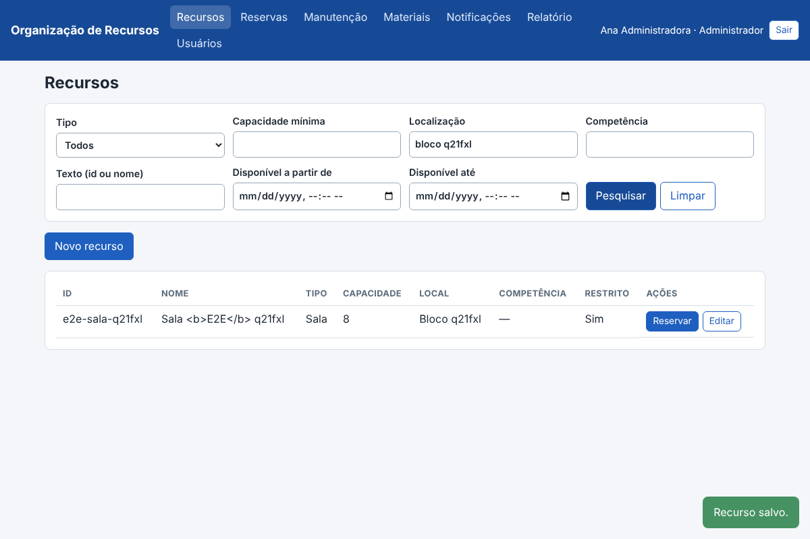
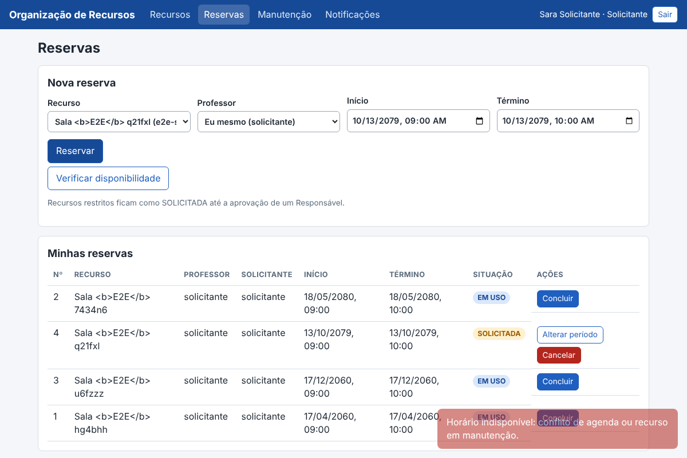
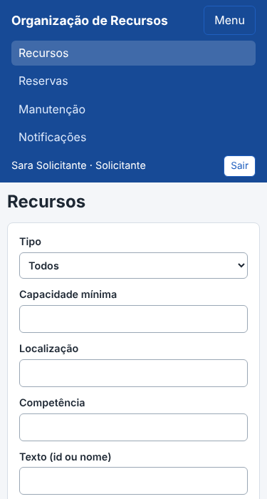

# Resultado do teste E2E da interface

Script: [`e2e/e2e.js`](../../e2e/e2e.js) (Playwright, Chromium). Procedimento: [`e2e/README.md`](../../e2e/README.md). **Não roda no CI**; foi executado manualmente no commit `75294e9` + as alterações desta entrega.

## Ambiente e execuções

| Item | Valor |
|---|---|
| Aplicação | perfil `postgres`, PostgreSQL 16.15 local, `APP_DEMO_DATA=true`, `E2E_EXPECT_CONFLICT=true` |
| Navegador | Chromium do Playwright (headless), janelas de 1200×800 e 375×700 |
| Execuções com PostgreSQL | 3 seguidas, **28/28 verificações em cada** |
| Execução sem banco (memória) | `27/27 verificações passaram` (sem a verificação de conflito de horário, que só vale com PostgreSQL) |

Uma primeira versão do script teve 3 falhas **do próprio script** (lia um aviso antigo na tela e checava a tabela da tela anterior). Foram corrigidas no script; o aplicativo não mudou.

## Saída da execução (PostgreSQL)

```
PASS  tela de login mostra o formulário
PASS  barra de navegação oculta antes do login
PASS  credenciais inválidas mostram mensagem compreensível
PASS  Administrador vê Usuários e Materiais — Recursos, Reservas, Manutenção, Materiais, Notificações, Relatório, Usuários
PASS  recurso cadastrado aparece na lista
PASS  HTML no nome é exibido como texto (sem injeção)
PASS  pesquisa por localização retorna só o recurso criado
PASS  período de manutenção listado
PASS  Solicitante não vê Usuários, Materiais nem Relatório — Recursos, Reservas, Manutenção, Notificações
PASS  Solicitante é redirecionado ao abrir rota de Administrador — http://127.0.0.1:8080/#/recursos
PASS  término antes do início é recusado com mensagem
PASS  reserva durante a manutenção é recusada
PASS  reserva de recurso restrito nasce SOLICITADA
PASS  Solicitante não vê o botão Aprovar
PASS  mesmo horário é recusado por conflito (PostgreSQL)
PASS  Responsável vê Materiais e Relatório
PASS  aprovação muda a reserva para APROVADA
PASS  histórico registra criação e aprovação
PASS  iniciar uso muda a reserva para EM USO
PASS  reserva EM USO não oferece cancelar
PASS  notificação de criação registrada
PASS  menu recolhido em tela estreita
PASS  menu abre ao tocar em Menu
PASS  sair volta ao login
PASS  sem erros de JavaScript não tratados
PASS  sem erros de JavaScript não tratados
PASS  sem erros de JavaScript não tratados
PASS  sem erros de JavaScript não tratados

28/28 verificações passaram
```

## O que cada verificação cobre

| Requisito | Verificações |
|---|---|
| RF-01 (perfis na interface) | Login inválido com mensagem compreensível; navegação por perfil (Administrador × Solicitante × Responsável); redirecionamento de rota proibida; sair volta ao login |
| RF-02, RF-03 | Cadastro de recurso pela tela, pesquisa por localização, nome com HTML exibido como texto |
| RF-04, RF-13 | Reserva criada; término antes do início recusado com mensagem |
| RF-05, RF-06 | Mesmo horário recusado por conflito (PostgreSQL) |
| RF-07, RF-10, RF-14, RF-15 | Recurso restrito nasce SOLICITADA; Solicitante sem botão Aprovar; aprovação pelo Responsável; histórico; iniciar uso; sem cancelar em EM USO |
| RF-08 | Período de manutenção cadastrado e reserva no período recusada |
| RF-11 | Notificação de criação registrada |
| RNF-04 | Menu recolhido e funcional em 375 px; sem erros de JavaScript não tratados em nenhuma sessão |

Prints desta execução:   

## Limitações

O E2E não cobre todas as telas (Materiais, Relatório e Usuários só têm a verificação de navegação por perfil), não mede acessibilidade (WCAG) nem outros navegadores, e exige execução manual.
